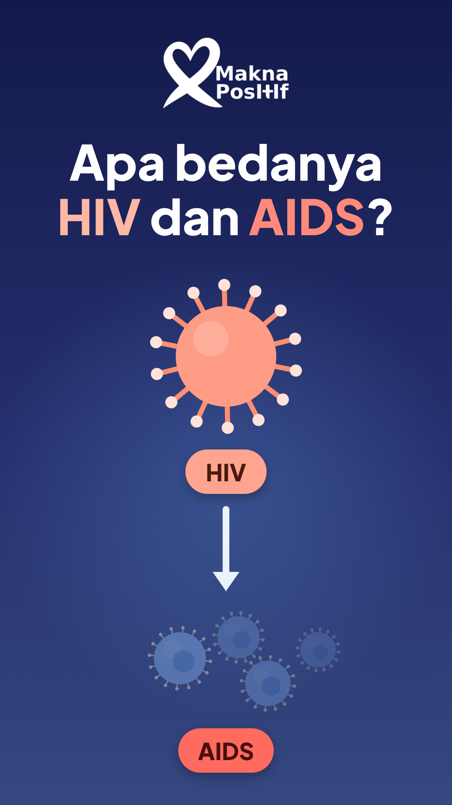

# video-ai

Template video edukasi HIV/ARV (9:16, hybrid 3D + flat), dibuat dengan Remotion.

Alur: baris GSheet "Antrean Konten AI (HIV)" -> mp3 dari Drive -> segmentasi jeda -> render lapisan 3D (Plate3D) + lapisan label (Overlay) -> komposit ffmpeg + loudnorm.

## Perintah
- `npm install`
- `npx remotion bundle src/index.ts --out-dir=out/bundle`
- Lapisan 3D: `npx remotion render out/bundle Plate3D out/plN.mp4 --frames=A-B --gl=swangle --muted`
- Lapisan label: `npx remotion render out/bundle Overlay out/overlay.webm --codec=vp8 --pixel-format=yuva420p --image-format=png`
- Gabung: lihat `scripts/hybrid.sh`

Catatan: episode lama (S1E1, S1E3, S1E6, S2E9; dulu ep2, ep3arv, ep5, ep3) memakai `public/vo.mp3` yang tidak disimpan di repo. Episode baru memakai konvensi kode episode di bawah.

## Konvensi episode baru (kode episode dari kolom `episode`, mis. S1E3)
- **Kode episode** = isi kolom `episode` di sheet, persis (S1E3). Dipakai untuk semua nama berkas.
- **Suara**: `public/vo/<KODE>.mp3` (mis. `public/vo/S1E3.mp3`), di-commit dan di-push oleh Arso ke repo. Kolom `link_dubbing` tidak dipakai lagi. Kalau berkas belum ada di repo, proses episode itu batal dan bilang mp3 mana yang kurang; jangan mengunduh dari Drive.
- **Kode**: folder `src/<kode huruf kecil>/` (mis. `src/s1e3/`), composition `<KODE>Full` (mis. `S1E3Full`), audio dibaca dengan `staticFile('vo/<KODE>.mp3')`. Jangan memakai `vo.mp3`.
- **Render**: `scripts/render_<kode huruf kecil>.sh` (potongan berurutan di `out/<KODE>/`, bisa dilanjut, gabung + loudnorm), hasil akhir `out/<KODE>.mp4`. Pola mengikuti `scripts/render_s1e3.sh`.

**Pemetaan nama lama ke kode episode** (nama folder lama diganti Nov 2026, isi kode tidak diubah): `ep2` = S1E1, `ep3arv` = S1E3, `ep5` = S1E6, `ep3` = S2E9 ("Bagaimana HIV memperbanyak diri?"). Composition: `S1E1Full`, `S1E3Full`, `S1E6Full`, `S2E9Full`. Render: `scripts/render_<kode>.sh` -> `out/<KODE>.mp4`. S1E2 dan S1E4 belum ada kodenya di repo ini.

---

## Gaya visual baku (berlaku untuk SEMUA episode baru)

Dipakai sebagai default. Referensi implementasi: `src/s1e1/` (episode "Apa bedanya HIV dan AIDS?", composition `S1E1Full` = `Plate2` + `Overlay2` + audio). Judul baru cukup dibuatkan `timeline.ts`, `World*.tsx`, `Overlay*.tsx` baru dengan aturan ini, tanpa tanya ulang soal gaya.

**Format**: 9:16, 1080x1920, 30 fps, Remotion 4, font Plus Jakarta Sans (400/600/800; tidak ada 700).

**Latar**
- Hanya gradien vertikal 3 warna. TIDAK ada bokeh/partikel melayang (2D maupun 3D).
- Warna gradien bergeser halus (±1,4 dtk) tiap pergantian scene, lihat `GRADS` di `World2.tsx`: biru laut (pembuka/sel), indigo (grafik CD4), ungu kebiruan (dua jalur), teal (viral load vs CD4), biru laut (rantai), hijau teal (ARV), biru lembut (penutup). Palet tetap dingin dan tenang, jangan merah/gelap mengancam.
- Di atas gradien ada glow radial lembut di tengah.

**Tidak ada indikator tahap/step pill bernomor.** Alur dibuat mengalir. Legenda hanya dipakai untuk visual abstrak (aturan di bawah).

**Legenda (kontekstual, hanya untuk hal abstrak)**
- Fungsi: menerjemahkan visual yang artinya tidak bisa ditebak dari bentuknya, misalnya DNA, enzim (mis. protease), virus, sel CD4, partikel/titik berwarna, grafik atau bar dengan 2 garis/warna atau lebih, dan analogi yang tidak langsung ketebak. Isinya mengikuti konteks adegan, bukan selalu HIV dan CD4.
- Tidak dipakai untuk objek yang sudah jelas dari bentuknya (orang, rumah, jam, kalender, hati, klinik). Tidak ada legenda "orang" untuk gambar orang. Tidak dobel dengan label pill untuk hal yang sama.
- Tampilan: pill kecil soft filled tanpa garis tepi di atas (y=250), titik warna + label, maksimal 3 item, fade halus.
- Waktu tampil: pertama kali objek abstrak muncul, tampil penuh sekitar 4-5 detik lalu fade. Muncul lagi hanya kalau objeknya kembali setelah jeda panjang (adegan lain tanpa objek itu), atau ada beberapa warna abstrak sekaligus yang rawan tertukar. Untuk grafik/bar, legenda tetap selama grafiknya ada di layar.
- Sumber: ditentukan pembuat video per adegan di kode episode (tidak ada scene-spec lagi). Adegan tanpa kebutuhan = tanpa legenda.
- Episode lama (S1E1, S1E3) masih memakai legenda statis versi lama (`SHOW_LEGEND` / `Legend`); episode baru ikut aturan ini.

**Label (pill)**
- Pill bulat terisi (tanpa garis tepi), bayangan lembut, teks tebal 800. Tidak harus tersambung garis ke objek.
- Palet `PK`: virus koral `#FF9C85`, sel/CD4 biru `#8FBDF7`, reseptor kuning `#F4D77E`, RT/ARV teal `#72E3D3`, buruk/AIDS merah `#FF6B5E`, netral `#EAF2FB`, abu `#B9C3D0`.
- Hemat: hanya istilah kunci. Kalimat yang sudah jelas di narasi/subtitle tidak diulang jadi label.

**Subtitle**
- Kecil, di y=1462, ukuran 42, tengah, bayangan teks; tidak menutupi animasi. Mengikuti kolom `narasi_final` di sheet.
- Kata kunci diberi warna aksen: CD4 biru `#8FBDF7`, HIV/virus/viral/load koral muda `#FFB7A5`, AIDS `#FF8A7A`, ARV teal `#72E3D3`, angka 200 kuning `#F4D77E` (tabel `ACC` di `Overlay2.tsx`).
- Subtitle disembunyikan saat teks penutup tampil.

**Kartu & grafik**: kartu berisi gradasi putih transparan + bayangan lembut, TANPA garis tepi. Grafik: sumbu `#E8F0FA`, CD4 biru `#8FBDF7`, viral load `#FF6B4D`, ambang 200 putus-putus kuning.

**Transisi**: tiap layer datar baru masuk dengan zoom-out halus (1,035 -> 1,0 dalam 1 dtk, fungsi `settle`); layer 3D hanya dipasang pada rentang 3D agar render hemat.

**Penutup**: teks muncul pelan berurutan (fade+naik ±1 dtk) sesuai narasi, gambar orang bergerak sangat halus. Kalimat terakhir selalu menampilkan referensi + logo, lihat bagian "Penutup: referensi jurnal + logo" di bawah.

**Pagar konten (wajib)**: tidak menampilkan nomor stadium (pakai "tahap lanjut"); ARV tidak digambarkan sebagai senjata; HIV tidak digambarkan hilang total (kurva viral load tetap di atas sumbu); tanpa citra pasien/rumah sakit.

**Render**: `scripts/render_s1e1.sh` (potongan berurutan, bisa dilanjut, lalu gabung + loudnorm I=-14). Bagian 3D ±4,4 dtk/frame (software GL), bagian datar ±0,5-0,9 dtk/frame; total ±1 jam untuk 82 dtk. Suara `public/vo.mp3` tidak disimpan di repo; ambil dari link_dubbing di sheet.

---

## Desain tokoh baku: CD4, virus HIV, komandan (wajib dipakai ulang di SEMUA episode baru)

Arso suka desain CD4 dan virus HIV dari video "Kenapa HIV menyerang CD4?" dan ingin seri berikutnya tetap memakai bentuk yang sama. Kode acuannya ada di `src/shared/shapes.tsx` (`FlatVirus`, `FlatCell`, `Figure`, `Star`, palet `SHAPE_COL`). Import dari sana, jangan menggambar ulang atau membuat varian baru.

- **Virus HIV (`FlatVirus`)**: bola koral `#FF9C85`, 14 duri pendek radial (batang `#FF8E70`, bulatan pucat `#FFE3DA` di ujung), highlight putih tipis di kiri atas. Tanpa wajah. Boleh diberi `rot` dan `dim`, bentuknya tidak diubah.
- **Sel CD4 (`FlatCell`)**: bola biru muda `#8FBDF7`, inti biru tua `#5B97E0` sedikit bergeser ke kanan bawah, highlight yang sama. Reseptor CD4 = batang kuning `#F4D77E` dengan bulatan kuning pucat `#FFF3C4` di ujung, melingkar di permukaan (`rec` 0..1 mengatur panjangnya, 16 batang). Sel kekebalan lain memakai `FlatCell` yang sama dengan warna netral (abu `#B9C3D0`, sel B `#C9C3E6`) dan tanpa reseptor.
- **Komandan = CD4 dalam analogi tentara (`Figure` dengan `cmd`)**: figur datar bertubuh biru `#8FBDF7`, topi biru tua `#5B97E0`, bintang emas `#F4D77E` di dada. Prajurit = figur yang sama tanpa bintang, warna netral.

### Katalog library objek (`src/shared/library.tsx`)

Selain `shapes.tsx`, semua objek di bawah ini WAJIB diimpor dari `src/shared/library.tsx` (video). Jangan menggambar ulang; kalau butuh objek baru, tambahkan dulu ke library, lalu catat di sini. Semua komponen: `cx, cy` (posisi), `s` (skala, default 1), `rot` (derajat), `op` (opacity). Warna dari `LIB_COL` (+ `SHAPE_COL`). Flat, tanpa outline, tanpa wajah.

| Kelompok | Komponen (parameter khusus) |
|---|---|
| Biologi | `TCytoCell`, `BCell`, `Antibody(color)`, `RNAStrand(len, phase)`, `DNAHelix(len)`, `Enzyme(kind: rt/integrase/protease)`, `Membrane(w, receptors:[{x, kind: cd4/ccr5/cxcr4}])` |
| Obat | `Capsule(colorA, colorB)`, `Tablet`, `Blister(taken)`, `PillBottle`, `Syringe(fill)` |
| Data | `LineChart(points, threshold, progress)`, `PercentBars(items:[{label,pct}])`, `Clock(frac, hour)`, `Calendar(marks)` |
| Tes | `BloodDrop`, `BloodTube(level)`, `TestKit(lines: 0/1/2)`, `CheckBadge`, `CrossBadge` |
| Analogi | `Train(wagons, wagonColor)`, `Station(label, state: open/blocked/virus)`, `Dam(level)`, `Battery(level)`, `City(lit)`, `Shield`, `Car(color)`, `Scoreboard(home, away, pending)`, `Gear(rust: 0..1)` |
| Lalu lintas (analogi) | `Road(w, h)` (jalan dengan marka tengah; mobil = `Car`) |
| Olahraga (analogi) | `Goal(net)` (gawang + jaring, net 0..1 = kembung), `Ball` |
| Data (lanjutan) | `CompareBars(labelA, labelB, pa, pb, mark)` (dua bar tanpa angka, B = 2,35x A, penanda 2x) |
| Manusia & tempat | `Person(color, kid)`, `Group(n)`, `Heart`, `Hug`, `MotherBaby`, `Home`, `Clinic`, `SpeechBubble(text, tail, w)`, `Lock(open)`, `Document(kind: paper/card, stamp)` |

### Alur pembuatan video (tanpa storyboard)

Video dibuat langsung dari `narasi_final` + `public/vo/<KODE>.mp3`. Kolom `storyboard` di sheet TIDAK dibaca dan tidak ada scene-spec JSON. Pembuat video merancang adegan sendiri lalu menuliskannya sebagai kode per episode di `src/<kode huruf kecil>/`.

1. **Bongkar mp3 dulu: sinkron per kalimat + jeda sesuai cerita.** ElevenLabs membaca narasi tanpa putus, jadi timing tidak boleh diambil dari proporsi karakter. Jalankan:
   - `node scripts/retime.mjs analyze <KODE> <narasi.txt>` (narasi.txt = `narasi_final` apa adanya, satu paragraf per baris). Skrip memotong narasi jadi kalimat dan klausa (batas koma/titik dua), mendeteksi jeda nyata di mp3 (`silencedetect`), lalu mencocokkan klausa ke jeda secara monoton. Hasil: `src/<kode>/segments.json` + laporan konsol. **Baca bagian "perlu dicek"**: kalimat yang jedanya terlalu pendek atau selisih waktunya besar harus dicek manual (dengar atau lihat spektrum), bukan diterima begitu saja. Kalau masih ragu, boleh transkripsi mp3 dengan `creative_transcribe_audio` (ElevenLabs, memakai kredit) hanya untuk episode yang ditandai.
   - Tulis `src/<kode>/holds.json`: `{ "default": 0.45, "tail": 6, "after": { "<no. kalimat>": detik } }`. `after` = jeda SETELAH kalimat itu. Atur menurut cerita: default 0,45 dtk; 0,9 sampai 1,4 dtk setelah hook, setelah kalimat yang memicu aksi visual penting (benda bergerak, berubah, terhalang), dan sebelum kalimat penutup; 1,5 sampai 2 dtk kalau aksinya panjang dan harus terlihat dulu. Jeda pendek (0,3 sampai 0,45) untuk kalimat lanjutan yang saling nyambung. Jangan menaruh jeda panjang di semua kalimat (jadi lamban); pilih titik yang memang butuh dilihat.
   - `node scripts/retime.mjs build <KODE>`: menyusun ulang audio per kalimat dengan jeda baru -> `out/<KODE>/vo_synced.wav` dan menulis `src/<kode>/sync.ts` (waktu VIDEO tiap kalimat dan klausa; jangan diedit tangan). Isi suara tidak diubah, hanya jedanya.
   - Di `timeline.ts`: `SEGS = toSegs(SYNC_SEGS)`, `CUES = makeCues(SYNC_SEGS)` (impor dari `src/shared/cues.ts`; subtitle per frasa menempel ke klausa, bukan dibagi proporsional satu kalimat penuh), `EP_DUR = SYNC_DUR`, `CLOSE = SEGS[terakhir].a`. `T(n)` = awal kalimat ke-n seperti biasa.
   - **Aturan animasi dan jeda**: aksi untuk kalimat n dimulai di `T(n)` dan harus tuntas paling lambat `SEGS[n-1].b + jeda setelahnya`; jeda dipakai untuk menahan hasil aksi supaya terlihat. Jangan memulai aksi kalimat berikutnya sebelum `T(n+1)`.
   - **Render**: script render memakai `out/<KODE>/vo_synced.wav` (bukan mp3 mentah) pada langkah mux: `ffmpeg -i video_tanpa_suara.mp4 -i out/<KODE>/vo_synced.wav -af "loudnorm=I=-14:TP=-1.5:LRA=7,apad" ...`. Jalankan `node scripts/retime.mjs build <KODE>` di awal script render. `<Audio>` di komposisi tidak dipakai di mode chunk, jadi tidak perlu diubah. Durasi total komposisi = `SYNC_DUR`.
2. **Cek library dulu, baru menggambar.** Untuk tiap objek yang dibutuhkan, cocokkan dengan katalog di atas dan export di `src/shared/shapes.tsx` / `src/shared/library.tsx` (termasuk variasi lewat props). Kalau ADA: impor dan pakai, jangan menggambar ulang SVG-nya. Kalau TIDAK ADA: buat komponen baru di `src/shared/library.tsx` (flat, tanpa outline, tanpa wajah, parameter `cx, cy, s, rot, op`, warna dari `LIB_COL`/`SHAPE_COL`, gaya mengikuti komponen sejenis), tambahkan barisnya ke tabel katalog di atas, jalankan `npx tsc --noEmit`, commit terpisah (`library: tambah <Nama>`), `git pull --rebase origin main`, lalu push, supaya bisa dipakai episode lain. Jangan membuat varian baru dari virus HIV, sel CD4, atau komandan, dan jangan mengubah komponen lain.
3. **Animasi harus bercerita.** Tiap kalimat/ide di narasi punya aksi visual yang menjelaskan isi kalimat itu (benda bergerak ke tujuan, menempel, terhalang, berubah, bertambah atau berkurang, menyatu, terbelah), disinkronkan ke saat kalimat diucapkan dan diprogram per objek dengan `interpolate`/`spring` (posisi, skala, rotasi, opacity). Gerak hias saja (goyang, melayang, fade masuk) bukan penjelasan dan tidak dihitung. Pola tiap adegan: setup (objek masuk), aksi inti (proses yang diceritakan), hasil (keadaan akhir yang jelas). Contoh untuk "obat menghalangi virus masuk sel": virus mendekat ke sel, perisai/kapsul bergeser menutup titik masuk, virus terpental lalu berhenti. Satu objek memegang satu peran yang sama sepanjang episode. Pagar konten tetap: tanpa perang/ledakan/kehancuran, orang dengan HIV tidak digambarkan sakit atau berbeda, klaim medis selaras dengan `narasi_final`, tanpa karakter berhak cipta.
4. **Legenda.** Ikuti aturan "Legenda" di atas. Pembuat video memutuskan sendiri adegan mana yang butuh (hanya visual abstrak) dan menuliskannya di kode adegan.
5. **Cek sebelum push.** Render still frame minimal tiga per adegan (awal, tengah, akhir) plus penutup. Ketiganya harus menunjukkan perubahan keadaan yang berarti, bukan objek yang hanya bergeser sedikit, dan tiap kalimat narasi harus punya aksi yang bisa ditunjuk di frame. Perbaiki dulu kalau belum.
6. **Struktur kode.** Folder `src/<kode huruf kecil>/` dengan `timeline.ts` dan komponen adegan yang ditulis per episode (acuan struktur: `src/s2e9/` dan `src/s1e6/`). Jangan memakai renderer generik yang memetakan daftar objek statis seperti `src/s1e3/` (hasilnya objek diam dengan fade). Penutup (logo, referensi, Dukung dan follow kami) mengikuti bagian "Penutup" di bawah; komponen penutupnya boleh disalin dari `src/ep3arv/Ep3Arv.tsx`.

### Revisi episode yang sudah jadi (tanpa bikin ulang)

Untuk video lama (S1E3, S1E5, S1E7, S1E8, dst.) yang suaranya terasa nyerocos, animasinya kecepatan, atau dubbing telat dari teks, jangan mulai dari nol. Cukup perintah singkat, misalnya "tolong sesuaikan S1E5" atau "sesuaikan S1E8, jeda lebih panjang di kalimat 4 dan 9". Prosedurnya (selisih minimal, adegan dan animasi dipertahankan):

1. `node scripts/retime.mjs analyze <KODE> narasi.txt` (narasi dari kolom `narasi_final` di sheet, atau gabungkan teks `SEGS` lama). Cek kalimat yang ditandai.
2. Tulis/ubah `src/<kode>/holds.json` sesuai konteks cerita (lihat aturan jeda di atas). Kalau user menyebut kalimat tertentu, patuhi itu.
3. `node scripts/retime.mjs build <KODE>`.
4. Di `src/<kode>/timeline.ts`: ganti hanya `SEGS`, `EP_DUR`, `CLOSE`, dan `CUES` supaya turunan dari `SYNC_SEGS` (tambah `import { SYNC_SEGS, SYNC_DUR } from './sync'` dan helper di `src/shared/cues.ts`). Biarkan `T(n)`, `SCENE_T`, dan semua animasi di komponen episode: semuanya menempel ke `T(n)`, jadi otomatis ikut waktu baru. Pastikan `SCENE_T` masih menunjuk kalimat yang benar (kalau jumlah kalimat berbeda dari timeline lama, sesuaikan indeksnya).
5. Aksi yang dipatok ke detik mutlak, mis. `T(14)+3.3`, perlu dicek ulang: durasi kalimat di audio sekarang apa adanya dari mp3, jadi pastikan aksi tuntas sebelum `T(n+1)`.
6. Ubah `scripts/render_<kode>.sh`: panggil `build` di awal dan mux `out/<KODE>/vo_synced.wav` menggantikan mp3 mentah.
7. `npx tsc --noEmit`, render still frame di awal, tengah, dan akhir tiap kalimat yang jedanya diubah (dan di sekitar `CLOSE`), commit (`sync: <KODE> jeda per kalimat`), `git pull --rebase origin main`, push. Render ulang dilakukan di MODE CHAT/MAC seperti biasa; file lama di `out/` tidak dipakai lagi.
8. Isi `narasi_final` dan sheet tidak diubah. Laporkan ke user: kalimat mana yang dijeda berapa detik dan kenapa, serta kalimat yang masih ditandai ragu.

Tema latar video (semuanya gelap, bergradasi, berganti halus antar adegan): biru laut `#0A1F3D→#123A60→#17506F`, indigo/ungu `#14183F→#2A2A6B→#3B4A8A`, teal-hijau `#08283A→#0F4A5C→#167A80`, biru tua `#0D1B45→#1E2F6B→#2B4A85`.

- Catatan: `src/s2e9/shapes.tsx` dan `src/s1e6/shapes5.tsx` punya versi lama (bergradasi). Episode baru memakai `src/shared/shapes.tsx`; episode lama boleh diselaraskan kalau dirender ulang.

## Penutup: referensi jurnal + logo (wajib, berlaku untuk SEMUA episode baru)

**Sumber data per baris sheet "Antrean"**: kolom `status` (task video hanya mengerjakan baris `siap`), `episode`, `judul`, `narasi_final` (teks + subtitle, sinkron dengan audio), `referensi` (daftar referensi ilmiah), `link_dubbing` (tidak dipakai untuk episode baru; suara dari `public/vo/<episode>.mp3`), `storyboard` (tidak dibaca; alur tanpa storyboard). Tidak ada kolom lain yang dibaca. Kolom dicari berdasarkan NAMA header di baris 1, bukan huruf kolom, jadi aman kalau kolom bergeser. Kolom `narasi` (header panjang berisi pola Hook → ... → callback) sudah tidak dipakai; jangan dibaca. Kolom `crosscheck` dan `narasi_revisi` sudah dihapus; jangan dicari. Narasi dibaca langsung dari `narasi_final`, sudah final dari Arso, jangan diubah.

**Saat kalimat penutup terakhir** (kalimat paling akhir di `narasi_final`) mulai diucapkan, tampilkan tiga hal bersamaan, bertahan sampai video selesai:
1. **Referensi jurnal**: isi kolom `referensi` apa adanya (judul sesuai baris pertama kolom, saat ini "Referensi"; entri bernomor, DOI/URL sebagai teks kecil). Jangan dipotong, diringkas, atau diganti. Kalau kolom kosong, panel referensi tidak ditampilkan, logo tetap muncul.
2. **Logo Makna Positif**: pakai file asli `public/logo-makna-positif.png` (1254x1254, PNG putih berlatar transparan, area isi sekitar x105-1172, y328-929). Jangan digenerate ulang atau digambar ulang.
3. **Kotak "Dukung dan follow kami"**: di bawah kotak referensi, isi dan gaya baku di bagian "Kotak Dukung dan follow kami" di bawah.

**Aturan tampilan**
- Fade-in pelan seperti elemen penutup lain; subtitle disembunyikan (sudah aturan penutup di atas).
- **Susunan baku (seragam di semua episode), dari atas ke bawah: logo Makna Positif, kotak referensi, kotak Dukung dan follow kami.** Logo: file 560x560 px, tengah horizontal, sisi atas file di y=60 (area isi logo sekitar 476 px lebar, pusat sekitar y=340). Kotak referensi mulai y=500. Kotak Dukung dan follow kami tepat di bawah kotak referensi dengan jarak 50 px (tinggi kotak referensi bisa berubah sesuai panjang referensi, jadi posisinya mengikuti, bukan angka tetap). Jangan dibalik atau diubah urutannya. Latar penutup: gradien #0A2540 → #0F3B66 (55%) → #0B4F63 + glow radial lembut di atas.
- Panel referensi: kartu soft filled tanpa garis tepi, Plus Jakarta Sans, teks kecil tapi terbaca di layar HP (target tinggi huruf ≥ 24 px di 1080x1920). Logo dan panel di area terpisah, tidak bertumpuk dengan teks. Kalau daftar referensi panjang, kecilkan ukuran teks (tidak di bawah 24 px) atau naikkan sedikit posisi logo, tapi urutan tetap logo di atas, panel di bawah.
- Logo berwarna putih, jadi latar scene penutup harus cukup gelap agar kontras terjaga. Tetap gradien polos dingin seperti aturan latar, tinggal pilih nada yang lebih dalam di scene ini.
- Kalau kalimat penutup terlalu pendek untuk membaca referensi, tambahkan ekor diam beberapa detik di akhir video; suara tidak diubah.

### Kotak Dukung dan follow kami (wajib, di bawah kotak referensi)

Kartu seragam dengan kotak referensi: x=60, lebar 960, radius 40, isi gradien putih transparan (0.14 → 0.08), bayangan lembut, tanpa garis tepi, padding 34/46 px. Judul "Dukung dan follow kami" (800, 38 px, putih). Isi: daftar horizontal 4 baris (tinggi baris 82 px), tiap baris dari kiri ke kanan: **ikon** (kotak membulat 58 px, radius 16, warna khas platform), **nama platform** (600, 30 px, lebar kolom tetap 190 px), **handle/alamat** (800, 28 px, putih, rata kiri tepat setelah kolom nama), dan **tombol aksi** (pill 196x52 px, teks 800 25 px putih, tanpa garis tepi) rata kanan sehingga tepi kanan semua tombol lurus. Handle Instagram, YouTube, dan TikTok: `@maknapositif`. Saweria bukan sistem @, jadi ditulis `saweria.co/maknapositif`.

| Baris | Ikon | Tombol |
|---|---|---|
| Instagram | gradien khas (#FEDA75 → #FA7E1E → #D62976 → #962FBF → #4F5BD5), glyph kamera putih | "+ Follow", biru #2F80ED |
| YouTube | merah #FF0000, glyph play putih | "+ Subscribe", biru #2F80ED |
| TikTok | hitam #0B0B0F, nada musik putih dengan bayangan cyan #25F4EE dan pink #FE2C55 | "+ Follow", biru #2F80ED |
| Saweria | oranye #F97316, glyph hati putih | "Donate" dengan ikon hati, oranye #F97316 |

Aturan: Threads TIDAK ditampilkan. Ikon digambar sendiri sebagai glyph sederhana berwarna khas (bukan logo resmi platform). Urutan baris tetap: Instagram, YouTube, TikTok, Saweria. Tidak ada outline/border di elemen mana pun.

Animasi (mengikuti gaya fade-in penutup lain): logo fade-in, lalu kotak referensi, lalu kotak Dukung dan follow kami; baris-baris masuk bergantian dari bawah sambil fade (jeda ±0,15 dtk antar baris). Setelah semua baris tampil: tombol Follow dan Subscribe "ditekan" (mengecil sebentar lalu kembali), lalu teksnya berubah jadi **"Following"** dan **"Subscribed"** dalam warna teal #14B8A6 dengan centang (bukan "Mengikuti"/"Berlangganan"). Tombol Donate berdenyut pelan dan ikon hatinya berdetak, tanpa berubah teks.

**Implementasi 2D flat penuh (acuan episode baru)**: `src/s2e9/` (composition `S2E9Full`; `timeline.ts` = segmen suara hasil deteksi jeda, `shapes.tsx` = bentuk flat sel/virus/DNA/kapsul, `S2E9.tsx` = adegan + subtitle + penutup referensi/logo). Render: `scripts/render_ep3.sh` (8 potongan, bisa dilanjut; set `BROWSER=` ke path Chromium bila perlu). Di mesin 2 CPU sekitar 6 menit per potongan, total ±50 menit untuk 3.591 frame. Durasi = suara + ekor diam 4 dtk.

---

## Thumbnail YouTube: template baku (9:16, 1080x1920, seukuran video)

Dipilih Arso (Nov 2026) dan berlaku untuk SEMUA episode. Kalau Arso bilang "buatkan thumbnail dengan judul ...", langsung bikin dengan template ini, tanpa tanya gaya lagi.

**Susunan (atas ke bawah, tetap)**
1. **Logo Makna Positif** di tengah atas (x=390, y=90, lebar 300), file asli `public/logo-makna-positif.png`, jangan digambar ulang.
2. **Teks = hanya judul episode**, persis seperti kolom `judul` di sheet. Tidak ada tagline, subjudul, atau kalimat tambahan karangan. Plus Jakarta Sans 800, ukuran 116, tengah, putih; kata kunci boleh diberi warna aksen seperti subtitle video (HIV koral muda `#FFB7A5`, AIDS `#FF8A7A`, CD4 biru `#8FBDF7`, ARV teal `#72E3D3`).
3. **Ilustrasi di bawahnya** sesuai isi judul, memakai tokoh baku dari `src/shared/shapes.tsx` (virus, sel CD4, komandan), bersih dan lega. Boleh ada pill label kunci (terisi, tanpa garis tepi) yang kata-katanya diambil dari judul. Tanpa teks lain.

**Zona aman profil (3:4)**: grid profil IG dan YouTube memotong thumbnail 9:16 menjadi 3:4 di tengah (1080x1440, yaitu y 240 sampai 1680 dari kanvas 1080x1920). Semua isi thumbnail (logo, judul, ilustrasi, pill) harus berada di dalam zona itu. `ThumbFrame` sudah mengecilkan seluruh isi (skala `SAFE_S` 0,76) ke y 300 sampai 1640, jadi koordinat di komposisi tetap ditulis dalam kanvas penuh seperti sebelumnya (logo x=390 y=90 lebar 300, judul ukuran 116, dst.) dan hasilnya otomatis masuk zona aman. Susunan, urutan, dan gaya tidak berubah. Cek hasil dengan memotong gambar ke `crop=1080:1440:0:240`; tidak boleh ada yang terpotong. Latar gradien tetap penuh 9:16.

**Latar berganti per episode**: gradien vertikal 3 warna, dipilih sesuai warna tema video episode itu (`THEMES` di `src/thumb/Thumb.tsx`: `biru`, `indigo`, `teal`, `biruLembut`; tambah tema baru kalau videonya memakai gradien lain). Tanpa bokeh, tanpa garis tepi, ada glow radial lembut.

**Cara membuat thumbnail episode baru**: di `src/thumb/Thumb.tsx` buat komponen baru yang membungkus `<ThumbFrame theme="..." title={...}>` dengan ilustrasi di dalamnya (contoh: `ThumbHivAids`), daftarkan di `src/Root.tsx` (`<Composition id="Thumb..." width={THUMB_W} height={THUMB_H} durationInFrames={1} />`), lalu render: `npx remotion still src/index.ts <IdKomposisi> docs/thumbnail/<judul-slug>.png`. Simpan hasil final per episode di `docs/thumbnail/` dan tambahkan ke daftar di bawah. Jangan menyimpan alternatif yang tidak terpilih.

**Daftar thumbnail jadi**
- "Apa bedanya HIV dan AIDS?": tema `indigo`, `docs/thumbnail/apa-bedanya-hiv-dan-aids.png` (komposisi `ThumbHivAids`).
- "Kenapa HIV menyerang CD4?": tema `biru`, `docs/thumbnail/kenapa-hiv-menyerang-cd4.png` (komposisi `ThumbCd4`).
- "Bagaimana HIV memperbanyak diri?": tema `ungu` (baru, gradien adegan dalam sel), `docs/thumbnail/bagaimana-hiv-memperbanyak-diri.png` (komposisi `ThumbReplikasi`). Judul dipecah 3 baris (Bagaimana HIV / memperbanyak / diri?) supaya ukuran 116 tetap terpakai.
- "Apa itu viral load? Bagaimana diukurnya?": tema `teal`, `docs/thumbnail/apa-itu-viral-load-bagaimana-diukurnya.png` (komposisi `ThumbViralLoad`).

---

## Episode ARV (sheet episode 3): "Bagaimana ARV menghentikan replikasi HIV?"

Dibuat otomatis dari scene-spec storyboard (artifact di kolom `storyboard`). Kode: `src/s1e3/` (`timeline.ts` = segmen suara hasil deteksi jeda + batas adegan, `spec.ts` = scene-spec disalin dari storyboard, `S1E3.tsx` = renderer generik spec -> komponen `src/shared/library.tsx` + subtitle `narasi_final` + penutup logo/referensi/Dukung dan follow kami). Composition `S1E3Full` (3.339 frame, 30 fps). Render: `bash scripts/render_s1e3.sh` (butuh `public/vo.mp3` dari `link_dubbing`; tidak di-commit). Tidak ada objek library baru. Catatan: waktu adegan di storyboard hanyalah estimasi (±87 dtk); timeline memakai durasi suara asli (105,25 dtk) + ekor diam 6 dtk. `FlatVirus`/`Clock`/`Calendar` yang cy-nya jatuh di zona subtitle (>1380) digeser naik (1340/1360/1340) lewat `NUDGE`.
- "Bagaimana ARV menghentikan replikasi HIV?": tema `teal`, `docs/thumbnail/bagaimana-arv-menghentikan-replikasi-hiv.png` (komposisi `ThumbArv`). Judul 3 baris (Bagaimana ARV / menghentikan / replikasi HIV?); kapsul ARV -> satu virus, dua salinan pucat (replikasi terhenti, virus tidak hilang).

---

## Episode S1E5: "Kenapa ARV harus diminum rutin?"

Tanpa storyboard. Kode: `src/s1e5/` (`timeline.ts` = kalimat narasi_final + batas adegan dari jeda suara, 14/14 batas ter-snap; `S1E5.tsx` = 6 adegan animasi + subtitle + penutup). Composition `S1E5Full` (2373 frame, 30 fps; suara 73,09 dtk + ekor 6 dtk). Render: `bash scripts/render_s1e5.sh` -> `out/S1E5.mp4`. Tidak ada objek library baru. Legenda: adegan 1 dan 2 (virus), 3 dan 6 (grafik), 4 (grafik + virus).

---

## Episode S1E7: "Apa yang terjadi kalau ARV dihentikan?"

Tanpa storyboard. Kode: `src/s1e7/` (`timeline.ts` = kalimat narasi_final + batas adegan dari jeda suara, 14/15 batas ter-snap; `S1E7.tsx` = 8 adegan animasi + subtitle + penutup). Composition `S1E7Full` (2331 frame, 30 fps; suara 71,71 dtk + ekor 6 dtk). Render: `bash scripts/render_s1e7.sh` -> `out/S1E7.mp4`. Objek library baru: `CompareBars`. Legenda: adegan 3 (virus), 4 (sel laten + virus), 5 dan 6 (grafik/CD4).

---

## Episode S1E8: "Apa itu window period HIV?"

Tanpa storyboard. Kode: `src/s1e8/` (`timeline.ts` = kalimat narasi_final + batas adegan dari jeda suara, 17/17 batas di jeda (6 digeser manual ke jeda yang cocok); `S1E8.tsx` = 10 adegan animasi + subtitle + penutup). Composition `S1E8Full` (2475 frame, 30 fps; suara 76,51 dtk + ekor 6 dtk). Render: `bash scripts/render_s1e8.sh` -> `out/S1E8.mp4`. Objek library baru: `Goal`, `Ball`. Legenda: adegan 3, 7, 10 (virus). Kolom `referensi` tanpa nomor: nomor tidak ditampilkan.

---

## Episode S1E9: "Apa arti viral load tidak terdeteksi?"

Tanpa storyboard. Kode: `src/s1e9/` (`timeline.ts` = kalimat narasi_final + batas adegan dari jeda suara, 19 kalimat; `S1E9.tsx` = 12 adegan animasi + subtitle + penutup). Composition `S1E9Full` (2624 frame, 30 fps; suara 72,83 dtk + jeda, total 87,45 dtk termasuk ekor 6 dtk). Render: `bash scripts/render_s1e9.sh` -> `out/S1E9.mp4`. Objek library baru: `Road`. Legenda: adegan 1, 2, 3, 4 (mobil = virus, grafik), 6, 7, 8, 9, 10, 12. Kalimat 14-15 ditandai ragu oleh retime (jeda 0,18 dtk), batas diterima setelah dicek silencedetect.

---

## Episode S1E10: "HIV bisa ada tanpa gejala. kok bisa?"

Tanpa storyboard. Kode: `src/s1e10/` (`timeline.ts` = kalimat narasi_final + batas adegan dari jeda suara, 19 kalimat; `S1E10.tsx` = 8 adegan animasi + subtitle + penutup). Composition `S1E10Full` (2765 frame, 30 fps; suara 74,03 dtk + jeda, total 92,14 dtk termasuk ekor 6 dtk). Render: `bash scripts/render_s1e10.sh` -> `out/S1E10.mp4`. Tidak ada objek library baru. Legenda: adegan 1 (virus), 2 (karat = virus, mesin = tubuh), 3 (virus), 4 (sel CD4, virus, grafik CD4), 5 (grafik CD4 + batas), 6 (virus, tabung darah). Kalimat 15 ditandai ragu oleh retime (jeda 0,24 dtk), batas diterima.
