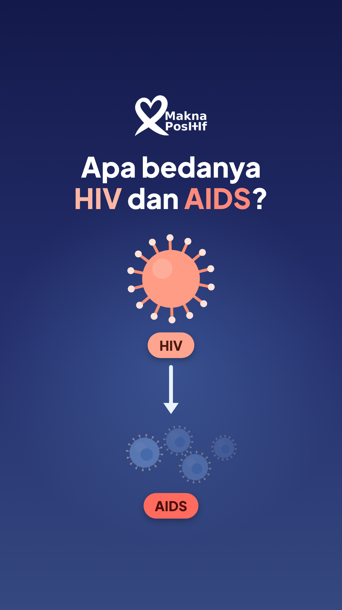

# video-ai

Template video edukasi HIV/ARV (9:16, hybrid 3D + flat), dibuat dengan Remotion.

Alur: baris GSheet "Antrean Konten AI (HIV)" -> mp3 dari Drive -> segmentasi jeda -> render lapisan 3D (Plate3D) + lapisan label (Overlay) -> komposit ffmpeg + loudnorm.

## Perintah
- `npm install`
- `npx remotion bundle src/index.ts --out-dir=out/bundle`
- Lapisan 3D: `npx remotion render out/bundle Plate3D out/plN.mp4 --frames=A-B --gl=swangle --muted`
- Lapisan label: `npx remotion render out/bundle Overlay out/overlay.webm --codec=vp8 --pixel-format=yuva420p --image-format=png`
- Gabung: lihat `scripts/hybrid.sh`

Catatan: episode lama (ep2, ep3, ep3arv, ep5) memakai `public/vo.mp3` yang tidak disimpan di repo. Episode baru memakai konvensi kode episode di bawah.

## Konvensi episode baru (kode episode dari kolom `episode`, mis. S1E3)
- **Kode episode** = isi kolom `episode` di sheet, persis (S1E3). Dipakai untuk semua nama berkas.
- **Suara**: `public/vo/<KODE>.mp3` (mis. `public/vo/S1E3.mp3`), di-commit dan di-push oleh Arso ke repo. Kolom `link_dubbing` tidak dipakai lagi. Kalau berkas belum ada di repo, proses episode itu batal dan bilang mp3 mana yang kurang; jangan mengunduh dari Drive.
- **Kode**: folder `src/<kode huruf kecil>/` (mis. `src/s1e3/`), composition `<KODE>Full` (mis. `S1E3Full`), audio dibaca dengan `staticFile('vo/<KODE>.mp3')`. Jangan memakai `vo.mp3`.
- **Render**: `scripts/render_<kode huruf kecil>.sh` (potongan berurutan di `out/<KODE>/`, bisa dilanjut, gabung + loudnorm), hasil akhir `out/<KODE>.mp4`. Pola mengikuti `scripts/render_ep3arv.sh`.
- **Hasil akhir untuk PWA**: setelah render, salin `out/<KODE>.mp4` ke `media/video/<KODE>.mp4` (mis. `media/video/S1E5.mp4`) dan commit. Cover di `media/cover/<KODE>.png`. Nama berkas selalu kode episode persis seperti kolom `episode` di sheet. PWA `app/maknapositif.html` membaca path ini; tidak ada kolom `link_video` di sheet. Jangan push ulang mp4 yang sama kecuali memang direvisi (riwayat git menyimpan semua versi).
- **Data PWA**: `media/episodes.json` = salinan kolom `episode`, `status`, `judul`, `tanggal_tayang`, `deskripsi_youtube`, `deskripsi_tiktok`, `deskripsi_instagram` dari sheet untuk episode yang sudah punya video atau cover. Diperbarui setiap kali episode baru dirender atau caption di sheet berubah (jalankan ulang sinkron dari sheet, jangan edit tangan). Kode di sheet bisa bergeser kalau urutan episode diubah; nama berkas di `media/` harus mengikuti kode TERBARU di sheet (contoh: video CD4 sekarang S3E2, `media/cover/S3E2.png`).
- Folder dan skrip episode lama tidak diubah.

---

## Gaya visual baku (berlaku untuk SEMUA episode baru)

Dipakai sebagai default. Referensi implementasi: `src/ep2/` (episode "Apa bedanya HIV dan AIDS?", composition `Ep2Full` = `Plate2` + `Overlay2` + audio). Judul baru cukup dibuatkan `timeline.ts`, `World*.tsx`, `Overlay*.tsx` baru dengan aturan ini, tanpa tanya ulang soal gaya.

**Format**: 9:16, 1080x1920, 30 fps, Remotion 4, font Plus Jakarta Sans (400/600/800; tidak ada 700).

**Latar**
- Hanya gradien vertikal 3 warna. TIDAK ada bokeh/partikel melayang (2D maupun 3D).
- Warna gradien bergeser halus (±1,4 dtk) tiap pergantian scene, lihat `GRADS` di `World2.tsx`: biru laut (pembuka/sel), indigo (grafik CD4), ungu kebiruan (dua jalur), teal (viral load vs CD4), biru laut (rantai), hijau teal (ARV), biru lembut (penutup). Palet tetap dingin dan tenang, jangan merah/gelap mengancam.
- Di atas gradien ada glow radial lembut di tengah.

**Tidak ada indikator tahap/step pill bernomor.** Alur dibuat mengalir. Legenda hanya dipakai untuk visual abstrak (aturan di bawah).

**Legenda (kontekstual, hanya untuk hal abstrak)**
- Fungsi: menerjemahkan visual yang artinya tidak bisa ditebak dari bentuknya, misalnya DNA, enzim (mis. protease), virus, sel CD4, partikel/titik berwarna, grafik atau bar dengan 2 garis/warna atau lebih, dan analogi yang tidak langsung ketebak. Isinya mengikuti konteks adegan, bukan selalu HIV dan CD4.
- Tidak dipakai untuk objek yang sudah jelas dari bentuknya (orang, rumah, jam, kalender, hati, klinik). Tidak ada legenda "orang" untuk gambar orang. Tidak dobel dengan label pill untuk hal yang sama.
- Tampilan: pill kecil soft filled tanpa garis tepi di atas (y=250), titik warna + label, maksimal 3 item, fade halus.
- Waktu tampil: pertama kali objek abstrak muncul, tampil penuh sekitar 4-5 detik lalu fade. Muncul lagi hanya kalau objeknya kembali setelah jeda panjang (adegan lain tanpa objek itu), atau ada beberapa warna abstrak sekaligus yang rawan tertukar. Untuk grafik/bar, legenda tetap selama grafiknya ada di layar.
- Sumber: ditentukan pembuat video per adegan di kode episode (tidak ada scene-spec lagi). Adegan tanpa kebutuhan = tanpa legenda.
- Episode lama (ep2, ep3arv) masih memakai legenda statis versi lama (`SHOW_LEGEND` / `Legend`); episode baru ikut aturan ini.

**Label (pill)**
- Pill bulat terisi (tanpa garis tepi), bayangan lembut, teks tebal 800. Tidak harus tersambung garis ke objek.
- Palet `PK`: virus koral `#FF9C85`, sel/CD4 biru `#8FBDF7`, reseptor kuning `#F4D77E`, RT/ARV teal `#72E3D3`, buruk/AIDS merah `#FF6B5E`, netral `#EAF2FB`, abu `#B9C3D0`.
- Hemat: hanya istilah kunci. Kalimat yang sudah jelas di narasi/subtitle tidak diulang jadi label.

**Subtitle**
- Kecil, di y=1462, ukuran 42, tengah, bayangan teks; tidak menutupi animasi. Mengikuti kolom `narasi_final` di sheet.
- Kata kunci diberi warna aksen: CD4 biru `#8FBDF7`, HIV/virus/viral/load koral muda `#FFB7A5`, AIDS `#FF8A7A`, ARV teal `#72E3D3`, angka 200 kuning `#F4D77E` (tabel `ACC` di `Overlay2.tsx`).
- Subtitle disembunyikan saat teks penutup tampil.

**Kartu & grafik**: kartu berisi gradasi putih transparan + bayangan lembut, TANPA garis tepi. Grafik: sumbu `#E8F0FA`, CD4 biru `#8FBDF7`, viral load `#FF6B4D`, ambang 200 putus-putus kuning.

**Transisi**: tiap layer datar baru masuk dengan zoom-out halus (1,035 -> 1,0 dalam 1 dtk, fungsi `settle`); layer 3D hanya dipasang pada rentang 3D agar render hemat.

**Penutup**: teks muncul pelan berurutan (fade+naik ±1 dtk) sesuai narasi, gambar orang bergerak sangat halus. Kalimat terakhir selalu menampilkan referensi + logo, lihat bagian "Penutup: referensi jurnal + logo" di bawah.

**Pagar konten (wajib)**: tidak menampilkan nomor stadium (pakai "tahap lanjut"); ARV tidak digambarkan sebagai senjata; HIV tidak digambarkan hilang total (kurva viral load tetap di atas sumbu); tanpa citra pasien/rumah sakit.

**Render**: `scripts/render_ep2.sh` (potongan berurutan, bisa dilanjut, lalu gabung + loudnorm I=-14). Bagian 3D ±4,4 dtk/frame (software GL), bagian datar ±0,5-0,9 dtk/frame; total ±1 jam untuk 82 dtk. Suara `public/vo.mp3` tidak disimpan di repo; ambil dari link_dubbing di sheet.

---

## Desain tokoh baku: CD4, virus HIV, komandan (wajib dipakai ulang di SEMUA episode baru)

Arso suka desain CD4 dan virus HIV dari video "Kenapa HIV menyerang CD4?" dan ingin seri berikutnya tetap memakai bentuk yang sama. Kode acuannya ada di `src/shared/shapes.tsx` (`FlatVirus`, `FlatCell`, `Figure`, `Star`, palet `SHAPE_COL`). Import dari sana, jangan menggambar ulang atau membuat varian baru.

- **Virus HIV (`FlatVirus`)**: bola koral `#FF9C85`, 14 duri pendek radial (batang `#FF8E70`, bulatan pucat `#FFE3DA` di ujung), highlight putih tipis di kiri atas. Tanpa wajah. Boleh diberi `rot` dan `dim`, bentuknya tidak diubah.
- **Sel CD4 (`FlatCell`)**: bola biru muda `#8FBDF7`, inti biru tua `#5B97E0` sedikit bergeser ke kanan bawah, highlight yang sama. Reseptor CD4 = batang kuning `#F4D77E` dengan bulatan kuning pucat `#FFF3C4` di ujung, melingkar di permukaan (`rec` 0..1 mengatur panjangnya, 16 batang). Sel kekebalan lain memakai `FlatCell` yang sama dengan warna netral (abu `#B9C3D0`, sel B `#C9C3E6`) dan tanpa reseptor.
- **Komandan = CD4 dalam analogi tentara (`Figure` dengan `cmd`)**: figur datar bertubuh biru `#8FBDF7`, topi biru tua `#5B97E0`, bintang emas `#F4D77E` di dada. Prajurit = figur yang sama tanpa bintang, warna netral.

### Katalog library objek (`src/shared/library.tsx`)

Selain `shapes.tsx`, semua objek di bawah ini WAJIB diimpor dari `src/shared/library.tsx` (video). Jangan menggambar ulang; kalau butuh objek baru, tambahkan dulu ke library, lalu catat di sini. Semua komponen: `cx, cy` (posisi), `s` (skala, default 1), `rot` (derajat), `op` (opacity). Warna dari `LIB_COL` (+ `SHAPE_COL`). Flat, tanpa outline, tanpa wajah.

| Kelompok | Komponen (parameter khusus) |
|---|---|
| Biologi | `TCytoCell`, `BCell`, `Antibody(color)`, `RNAStrand(len, phase)`, `DNAHelix(len)`, `Enzyme(kind: rt/integrase/protease)`, `Membrane(w, receptors:[{x, kind: cd4/ccr5/cxcr4}])` |
| Obat | `Capsule(colorA, colorB)`, `Tablet` (ARV/TLD, juga untuk PEP: kapsul oranye muda salem `#FFA27B` rata + coakan pendek, tanpa kilau), `TabletPrEP` (PrEP: tablet biru muda bertulisan "PrEP"; PrEP dan ARV/TLD/PEP selalu beda warna), `Blister(taken)` (6 tablet ARV kapsul oranye), `PillBottle`, `Syringe(fill)` |
| Data | `LineChart(points, threshold, progress, smooth)` (smooth = kurva mulus tanpa patahan), `PercentBars(items:[{label,pct}])`, `Clock(frac, hour)`, `Calendar(marks)` |
| Tes | `Magnifier` (kaca pembesar; isi lensa digambar adegan, clipPath lingkaran r=92*s), `BloodDrop`, `BloodTube(level)`, `TestKit(lines: 0/1/2)`, `CheckBadge`, `CrossBadge` |
| Analogi | `Train(wagons, wagonColor)`, `Station(label, state: open/blocked/virus)`, `Dam(level)`, `Battery(level)`, `City(lit)`, `Shield`, `Car(color)`, `Scoreboard(home, away, pending)`, `Gear(rust: 0..1)` |
| Lalu lintas (analogi) | `Road(w, h)` (jalan dengan marka tengah; mobil = `Car`) |
| Olahraga (analogi) | `Goal(net)` (gawang + jaring, net 0..1 = kembung), `Ball` |
| Data (lanjutan) | `CompareBars(labelA, labelB, pa, pb, mark)` (dua bar tanpa angka, B = 2,35x A, penanda 2x) |
| Pose (S2E2) | `PersonPose(color, bow, lift)` (orang berpose: `bow` -1 lega .. 0 netral .. 1 tertunduk, `lift` 0..1 lengan terangkat; Person lama tidak diubah) |
| Uang (analogi) | `Coin` (koin polos; dengan `CrossBadge` = gratis) |
| Manusia & tempat | `Person(color, kid)`, `Group(n)`, `Heart`, `Hug`, `MotherBaby`, `Home`, `Clinic`, `SpeechBubble(text, tail, w)`, `Lock(open)`, `Document(kind: paper/card, stamp)` |
| Peran & pose (S2E1) | `Doctor(color)` (jas putih + stetoskop), `PointHand(flip)` (tangan menuding, menghakimi; menunjuk kiri, `flip` = menunjuk kanan), `Embrace(colorA, colorB, heart)` (dua orang saling merangkul), `BodyLens` (virus di dalam lensa bening di dada), `Tie(len, broken)` (ikatan manik, putus saat broken 0..1), `DiningTable(w)` (meja makan + piring + gelas), `Sun` (matahari pagi) |
| Lengan & ruang (S2E1 alt) | `ArmReach(len, color)` (lengan menjangkau; `rot` = arah dari bahu), `Chair`, `DeskFront(w)` (meja konsultasi, digambar setelah orang agar terlihat duduk), `Vessel(w, h)` (pembuluh darah abstrak) |
| Infeksi lain (S2E6) | `Microbe(color)` (kuman kapsul ungu muda dengan bintik dan bulu getar; untuk infeksi menular seksual lain/mikroba umum, BUKAN varian HIV) |
| Serangga (S2E7) | `Mosquito(belly, wing, prob)` (nyamuk: perut bisa terisi darah 0..1, `wing` = fase kepakan, `prob` = panjang belalai; belalai ke kanan, putar lewat `rot`) |
| Biji (S2E8) | `Seed(sprout)` (biji analogi virus yang tertidur di tanah; `sprout` 0..1 = tunas hijau; BUKAN varian HIV) |
| Alat pribadi (S2E9) | `Razor(color)` (pisau cukur), `Toothbrush(color)` (sikat gigi); keduanya menghadap atas |

### Karakter modular (`src/shared/actor.tsx`): untuk episode bercerita, bukan skala mikro

Dipakai untuk adegan yang tokohnya manusia (S2 dan seterusnya: orang, dokter, keluarga, masyarakat). Adegan skala mikro (virus, sel CD4, darah) TETAP memakai `shapes.tsx`/`library.tsx`. File ini terpisah dan tidak mengubah `Person`, `PersonPose`, `Doctor`, dkk di `library.tsx`; episode lama (S2E1, S2E2, dst.) tidak berubah sampai diminta direvisi.

Satu anatomi, empat identitas. Kepala besar (diameter 124), badan berisi, lengan dan kaki kapsul gemuk, tanpa wajah, flat, tanpa outline. Tinggi sekitar 5,8 kepala. Semua tokoh memakai bentuk, proporsi, dan rig yang sama; yang beda hanya warna dan atribut.

| Peran (`role`) | Warna | Dipakai untuk |
|---|---|---|
| `blue` | biru | tokoh utama ("kamu") |
| `purple` | ungu + jas putih + stetoskop (otomatis; matikan dengan `coat={false}`) | dokter |
| `yellow` | kuning | keluarga / orang terdekat |
| `teal` | teal | masyarakat / orang lain |
| `pink` | pink + ikat kuda (default) | tokoh perempuan, mis. pasangan tokoh utama |

**Gender = rambut, bukan warna.** Prop `hair` (`'ponytail'` ikat kuda dengan ikat rambut putih, `'bun'` cepol, `'bob'` pendek, `'none'` tanpa rambut = cowok) bisa dipasang di role warna mana pun, mis. `<Actor role="teal" hair="bob" />` untuk perempuan di masyarakat. Default: `pink` = `ponytail`, role lain = `none`. Warna rambut otomatis versi gelap dari warna role; ganti lewat `hairColor`. Rambut hanya layer di kepala (ikut miring), anatomi tidak berubah. Pasangan cowok-cewek: tokoh cowok `blue`/warna biasa tanpa rambut, tokoh cewek `pink` (atau role lain + `hair`).

Komponen (semua: `cx, cy, s, rot, op`, ditambah `role`, `pose`, `debug`):
- `Actor` = tampak depan. `pose` = `{ head, lean, armL, armR, legL, legR }`; tiap lengan/kaki = `[sendi besar, siku/lutut, pergelangan]` dalam derajat.
- `ActorSide` = tampak samping (menghadap kanan), fleksi nyata: duduk, jalan, membungkuk. `pose` = `{ head, lean, armN, armF, legN, legF }` (N = sisi dekat penonton, F = sisi jauh).
- `Chair` = kursi (objek terpisah). Orang duduk memakai `POSES_SIDE.duduk`; geser orang+kursi bersama `translate(0 136)` supaya telapak kaki menapak.
- Preset pose yang sudah diuji: `POSES_FRONT` (`berdiri`, `tanganDiDada`, `kepalaMiring`, `melangkah`, `lenganNaik`), `POSES_SIDE` (`berdiri`, `duduk`, `jalan`, `menunjukAtas`, `membungkuk`, `tanganDiDagu`). Pose bisa diinterpolasi per frame (angka-angka sendi), jadi gerak tinggal `interpolate` antar pose.
- `PartPreview` = tiap bagian tubuh terpisah beserta pivotnya (untuk lembar anatomi/debug).

Aturan:
- Jangan mengubah bentuk dasar (kepala, torso, lengan, kaki, palet). Revisi pose cukup lewat sudut sendi.
- Sudut sendi dibatasi otomatis supaya pose tetap terbaca (siku maks 135 derajat, lutut maks 125 derajat, dst.). Jangan memaksa pose ekstrem.
- Tampak depan tidak bisa menoleh atau membungkuk ke depan; pakai `ActorSide` untuk itu. Kepala tanpa wajah hanya bisa miring, bukan menengok.
- Warna "kamu" (biru) tidak dipakai untuk benda lain (aturan "Satu warna, satu peran" tetap berlaku).
- Atribut baru (mis. perawat, seragam sekolah) = layer pakaian tambahan seperti jas dokter, bukan anatomi baru.

### Alur pembuatan video (tanpa storyboard)

Video dibuat langsung dari `narasi_final` + `public/vo/<KODE>.mp3`. Kolom `storyboard` di sheet TIDAK dibaca dan tidak ada scene-spec JSON. Pembuat video merancang adegan sendiri lalu menuliskannya sebagai kode per episode di `src/<kode huruf kecil>/`.

1. **Bongkar mp3 dulu: sinkron per kalimat + jeda sesuai cerita.** ElevenLabs membaca narasi tanpa putus, jadi timing tidak boleh diambil dari proporsi karakter. Jalankan:
   - `node scripts/retime.mjs analyze <KODE> <narasi.txt>` (narasi.txt = `narasi_final` apa adanya, satu paragraf per baris). Skrip memotong narasi jadi kalimat dan klausa (batas koma/titik dua), mendeteksi jeda nyata di mp3 (`silencedetect`), lalu mencocokkan klausa ke jeda secara monoton. Hasil: `src/<kode>/segments.json` + laporan konsol. **Baca bagian "perlu dicek"**: kalimat yang jedanya terlalu pendek atau selisih waktunya besar harus dicek manual (dengar atau lihat spektrum), bukan diterima begitu saja. Kalau masih ragu, boleh transkripsi mp3 dengan `creative_transcribe_audio` (ElevenLabs, memakai kredit) hanya untuk episode yang ditandai.
   - Tulis `src/<kode>/holds.json`: `{ "default": 0.45, "tail": 6, "after": { "<no. kalimat>": detik } }`. `after` = jeda SETELAH kalimat itu. Atur menurut cerita: default 0,45 dtk; 0,9 sampai 1,4 dtk setelah hook, setelah kalimat yang memicu aksi visual penting (benda bergerak, berubah, terhalang), dan sebelum kalimat penutup; 1,5 sampai 2 dtk kalau aksinya panjang dan harus terlihat dulu. Jeda pendek (0,3 sampai 0,45) untuk kalimat lanjutan yang saling nyambung. Jangan menaruh jeda panjang di semua kalimat (jadi lamban); pilih titik yang memang butuh dilihat. Batas total: lihat "Aturan kualitas" di bawah (maks sekitar 10% durasi suara).
   - `node scripts/retime.mjs build <KODE>`: menyusun ulang audio per kalimat dengan jeda baru -> `out/<KODE>/vo_synced.wav` dan menulis `src/<kode>/sync.ts` (waktu VIDEO tiap kalimat dan klausa; jangan diedit tangan). Isi suara tidak diubah, hanya jedanya.
   - Di `timeline.ts`: `SEGS = toSegs(SYNC_SEGS)`, `CUES = makeCues(SYNC_SEGS)` (impor dari `src/shared/cues.ts`; subtitle per frasa menempel ke klausa, bukan dibagi proporsional satu kalimat penuh), `EP_DUR = SYNC_DUR`, `CLOSE = SEGS[terakhir].a`. `T(n)` = awal kalimat ke-n seperti biasa.
   - **Aturan animasi dan jeda**: aksi untuk kalimat n dimulai di `T(n)` dan harus tuntas paling lambat `SEGS[n-1].b + jeda setelahnya`; jeda dipakai untuk menahan hasil aksi supaya terlihat. Jangan memulai aksi kalimat berikutnya sebelum `T(n+1)`.
   - **Render**: script render memakai `out/<KODE>/vo_synced.wav` (bukan mp3 mentah) pada langkah mux: `ffmpeg -i video_tanpa_suara.mp4 -i out/<KODE>/vo_synced.wav -af "loudnorm=I=-14:TP=-1.5:LRA=7,apad" ...`. Jalankan `node scripts/retime.mjs build <KODE>` di awal script render. `<Audio>` di komposisi tidak dipakai di mode chunk, jadi tidak perlu diubah. Durasi total komposisi = `SYNC_DUR`.
2. **Cek library dulu, baru menggambar.** Untuk tiap objek yang dibutuhkan, cocokkan dengan katalog di atas dan export di `src/shared/shapes.tsx` / `src/shared/library.tsx` (termasuk variasi lewat props). Kalau ADA: impor dan pakai, jangan menggambar ulang SVG-nya. Kalau TIDAK ADA: buat komponen baru di `src/shared/library.tsx` (flat, tanpa outline, tanpa wajah, parameter `cx, cy, s, rot, op`, warna dari `LIB_COL`/`SHAPE_COL`, gaya mengikuti komponen sejenis), tambahkan barisnya ke tabel katalog di atas, jalankan `npx tsc --noEmit`, commit terpisah (`library: tambah <Nama>`), `git pull --rebase origin main`, lalu push, supaya bisa dipakai episode lain. Jangan membuat varian baru dari virus HIV, sel CD4, atau komandan, dan jangan mengubah komponen lain.
   **TOKOH MANUSIA (WAJIB, berlaku untuk episode baru): pakai karakter modular `src/shared/actor.tsx` (bagian "Karakter modular" di atas), BUKAN `Person`, `PersonPose`, `Doctor`, `Embrace`, dkk, dan jangan menggambar tokoh manusia sendiri di adegan.** Peran: `blue` = tokoh utama, `purple` = dokter (jas + stetoskop otomatis), `yellow` = keluarga, `teal` = masyarakat. Gerak lewat sudut sendi dan `interpolate` antar pose (`POSES_FRONT`/`POSES_SIDE`). Kalau butuh pose atau atribut yang belum ada, tambahkan ke `actor.tsx` (preset pose baru atau layer pakaian), jangan mengubah bentuk dasar karakter, catat di README, commit terpisah, push SEGERA.
3. **Animasi harus bercerita.** Tiap kalimat/ide di narasi punya aksi visual yang menjelaskan isi kalimat itu (benda bergerak ke tujuan, menempel, terhalang, berubah, bertambah atau berkurang, menyatu, terbelah), disinkronkan ke saat kalimat diucapkan dan diprogram per objek dengan `interpolate`/`spring` (posisi, skala, rotasi, opacity). Gerak hias saja (goyang, melayang, fade masuk) bukan penjelasan dan tidak dihitung. Pola tiap adegan: setup (objek masuk), aksi inti (proses yang diceritakan), hasil (keadaan akhir yang jelas). Contoh untuk "obat menghalangi virus masuk sel": virus mendekat ke sel, perisai/kapsul bergeser menutup titik masuk, virus terpental lalu berhenti. Satu objek memegang satu peran yang sama sepanjang episode. Pagar konten tetap: tanpa perang/ledakan/kehancuran, orang dengan HIV tidak digambarkan sakit atau berbeda, klaim medis selaras dengan `narasi_final`, tanpa karakter berhak cipta.
4. **Legenda.** Ikuti aturan "Legenda" di atas. Pembuat video memutuskan sendiri adegan mana yang butuh (hanya visual abstrak) dan menuliskannya di kode adegan.
5. **Cek sebelum push.** Render still frame minimal tiga per adegan (awal, tengah, akhir) plus penutup. Ketiganya harus menunjukkan perubahan keadaan yang berarti, bukan objek yang hanya bergeser sedikit, dan tiap kalimat narasi harus punya aksi yang bisa ditunjuk di frame. Perbaiki dulu kalau belum.
6. **Struktur kode.** Folder `src/<kode huruf kecil>/` dengan `timeline.ts` dan komponen adegan yang ditulis per episode (acuan struktur: `src/ep3/` dan `src/ep5/`). Jangan memakai renderer generik yang memetakan daftar objek statis seperti `src/ep3arv/` (hasilnya objek diam dengan fade). Penutup (logo, referensi, Dukung dan follow kami) mengikuti bagian "Penutup" di bawah; komponen penutupnya boleh disalin dari `src/ep3arv/Ep3Arv.tsx`.

### Aturan kualitas (WAJIB; ditambah setelah revisi S2E1, yang jedanya terlalu panjang dan visualnya generik)

1. **Anggaran jeda.** Total jeda yang disisipkan `holds.json` maksimal sekitar 10% durasi suara (mis. suara 67 dtk, jeda total <= 7 dtk). Default 0,45 dtk; jeda >= 1,0 dtk hanya di 3 sampai 4 titik (setelah hook, setelah kalimat inti yang memicu aksi besar, sebelum penutup). Dua kalimat yang saling menyambung (mis. dua pertanyaan beruntun) jedanya 0,3 sampai 0,45 dtk. Setelah `build`, hitung total jeda dan laju kalimat (suku kata per dtk); kalau ada kalimat di luar 4,5 sampai 7 suku kata/dtk, batasnya diragukan: cek ulang (spektrum atau `creative_transcribe_audio`) sebelum lanjut. Subtitle tidak boleh hilang lama: selama jeda, subtitle terakhir ditahan sampai kalimat berikutnya.
2. **Bikin objek baru kalau perlu, jangan memaksa ikon lama.** Tokoh yang berperan beda harus TERBACA beda dari bentuknya: dokter = `Actor role="purple"` (jas putih + stetoskop) dari `src/shared/actor.tsx`, bukan sekadar beda warna. Aksi seperti menoleh/berbalik, menjauh, menutup mulut, menuding harus digambar sebagai pose/komponen, bukan diganti teks atau fade. Objek baru ditambah ke `src/shared/library.tsx`, dicatat di katalog, di-commit terpisah dan di-push SEGERA (langkah 2 di atas), bukan ditunda. Jangan mengubah komponen lama; buat komponen/varian baru.
3. **Tidak ada teks karangan di gambar.** Teks di gelembung, pill, dan label hanya boleh kata yang ADA di narasi_final atau istilah kunci resmi (ARV, CD4, dst). Gelembung ucap boleh berisi kata dari narasi (mis. "positif HIV" diucapkan dokter) atau titik-titik/tanda tanya; dilarang gelembung berisi kata kerja karangan seperti "jauh", "salah!". Ide "menjauh/menghakimi/menolak" digambar lewat gerak dan pose.
4. **Satu warna, satu peran.** Warna tokoh "kamu" tidak dipakai untuk benda lain (mobil, meja, ikon). Benda memakai `LIB_COL`/netral.
5. **Benda harus lengkap dan terbaca**: meja makan = meja + piring/gelas; virus di dalam tubuh = virus di dalam siluet/lingkaran jelas, bukan bintik di atas badan; hindari citra orang sakit.
6. **Cek visual sebelum push (kritis, bukan sekadar "ada yang berubah")**: untuk tiap adegan tanya: apakah penonton yang tidak membaca subtitle bisa menebak maknanya dari gambar? apakah ada benda yang cuma hiasan? apakah ada teks karangan? Perbaiki dulu. Putar juga satu potongan hasil render (mis. `ffmpeg` ambil frame tiap 1 dtk di sekitar jeda terpanjang) untuk memastikan tidak ada layar kosong tanpa gerak/teks lebih dari ~1,5 dtk.
7. **Jangan menyatakan "lolos" tanpa bukti**: laporan akhir menyebut laju kalimat yang janggal dan total jeda (dtk dan persen).

### Revisi karakter: "pakai karakter modular" (untuk video yang sudah jadi)

Perintah singkat, misalnya "S2E3 pakai karakter modular". Artinya: ganti SEMUA tokoh manusia di episode itu dengan `Actor`/`ActorSide` dari `src/shared/actor.tsx`, tanpa mengubah narasi, jeda, subtitle, atau adegan non-manusia. Prosedur:

1. `git pull origin main`; pastikan `src/shared/actor.tsx` ada. Kalau tidak ada, berhenti dan lapor.
2. Default = buat VERSI ALTERNATIF, bukan menimpa: salin `src/<kode>/` jadi `src/<kode>alt/` (composition `<KODE>AltFull`, script `scripts/render_<kode>alt.sh`, didaftarkan di `src/Root.tsx`). Komposisi lama tetap utuh sampai Arso bilang "ganti permanen"; baru saat itu komposisi lama diganti.
3. Di salinan itu, tiap `Person`, `PersonPose`, `Doctor`, `Embrace`, `ArmReach`, dan tokoh manusia gambaran sendiri diganti `Actor`/`ActorSide` sesuai peran warna lama (kamu = `blue`, dokter = `purple`, keluarga/pasangan/orang dekat = `yellow`, orang lain = `teal`). Pose dibuat dari sudut sendi, interpolasi per frame. Timeline (`sync.ts`, `holds.json`, `segments.json`), subtitle, dan objek non-manusia tidak diubah.
4. Jangan membuat karakter manusia versi baru di dalam episode. Kalau pose tidak bisa dibuat dengan `Actor`, tambahkan pose/atribut ke `actor.tsx` (lihat aturan di bawah "Karakter modular").
5. `npx tsc --noEmit`; `grep -rn "Person\|Doctor\|Embrace\|ArmReach" src/<kode>alt/` harus kosong untuk tokoh manusia; render still awal/tengah/akhir tiap adegan bertokoh dan cek terbaca (tidak menumpuk, tidak ada sendi putus).
6. Catat di README di bagian episode itu ("Versi lain dari <KODE> dengan karakter modular ...", seperti S2E2Alt), commit terpisah, `git pull --rebase origin main`, push ke main.

### Revisi episode yang sudah jadi (tanpa bikin ulang)

Untuk video lama (S1E3, S1E5, S1E7, S1E8, dst.) yang suaranya terasa nyerocos, animasinya kecepatan, atau dubbing telat dari teks, jangan mulai dari nol. Cukup perintah singkat, misalnya "tolong sesuaikan S1E5" atau "sesuaikan S1E8, jeda lebih panjang di kalimat 4 dan 9". Prosedurnya (selisih minimal, adegan dan animasi dipertahankan):

1. `node scripts/retime.mjs analyze <KODE> narasi.txt` (narasi dari kolom `narasi_final` di sheet, atau gabungkan teks `SEGS` lama). Cek kalimat yang ditandai.
2. Tulis/ubah `src/<kode>/holds.json` sesuai konteks cerita (lihat aturan jeda di atas). Kalau user menyebut kalimat tertentu, patuhi itu.
3. `node scripts/retime.mjs build <KODE>`.
4. Di `src/<kode>/timeline.ts`: ganti hanya `SEGS`, `EP_DUR`, `CLOSE`, dan `CUES` supaya turunan dari `SYNC_SEGS` (tambah `import { SYNC_SEGS, SYNC_DUR } from './sync'` dan helper di `src/shared/cues.ts`). Biarkan `T(n)`, `SCENE_T`, dan semua animasi di komponen episode: semuanya menempel ke `T(n)`, jadi otomatis ikut waktu baru. Pastikan `SCENE_T` masih menunjuk kalimat yang benar (kalau jumlah kalimat berbeda dari timeline lama, sesuaikan indeksnya).
5. Aksi yang dipatok ke detik mutlak, mis. `T(14)+3.3`, perlu dicek ulang: durasi kalimat di audio sekarang apa adanya dari mp3, jadi pastikan aksi tuntas sebelum `T(n+1)`.
6. Ubah `scripts/render_<kode>.sh`: panggil `build` di awal dan mux `out/<KODE>/vo_synced.wav` menggantikan mp3 mentah.
7. `npx tsc --noEmit`, render still frame di awal, tengah, dan akhir tiap kalimat yang jedanya diubah (dan di sekitar `CLOSE`), commit (`sync: <KODE> jeda per kalimat`), `git pull --rebase origin main`, push. Render ulang dilakukan di MODE CHAT/MAC seperti biasa; file lama di `out/` tidak dipakai lagi.
8. Isi `narasi_final` dan sheet tidak diubah. Laporkan ke user: kalimat mana yang dijeda berapa detik dan kenapa, serta kalimat yang masih ditandai ragu.

Tema latar video (semuanya gelap, bergradasi, berganti halus antar adegan): biru laut `#0A1F3D→#123A60→#17506F`, indigo/ungu `#14183F→#2A2A6B→#3B4A8A`, teal-hijau `#08283A→#0F4A5C→#167A80`, biru tua `#0D1B45→#1E2F6B→#2B4A85`.

- Catatan: `src/ep3/shapes.tsx` dan `src/ep5/shapes5.tsx` punya versi lama (bergradasi). Episode baru memakai `src/shared/shapes.tsx`; episode lama boleh diselaraskan kalau dirender ulang.

## Penutup: referensi jurnal + logo (wajib, berlaku untuk SEMUA episode baru)

**Sumber data per baris sheet "Antrean"**: kolom `status` (task video hanya mengerjakan baris `siap`), `episode`, `judul`, `narasi_final` (teks + subtitle, sinkron dengan audio), `referensi` (daftar referensi ilmiah), `link_dubbing` (tidak dipakai untuk episode baru; suara dari `public/vo/<episode>.mp3`), `storyboard` (tidak dibaca; alur tanpa storyboard). Tidak ada kolom lain yang dibaca. Kolom dicari berdasarkan NAMA header di baris 1, bukan huruf kolom, jadi aman kalau kolom bergeser. Kolom `narasi` (header panjang berisi pola Hook → ... → callback) sudah tidak dipakai; jangan dibaca. Kolom `crosscheck` dan `narasi_revisi` sudah dihapus; jangan dicari. Narasi dibaca langsung dari `narasi_final`, sudah final dari Arso, jangan diubah.

**Setelah seluruh narasi dan animasinya selesai** (kalimat terakhir selesai diucapkan, `CLOSE` = akhir kalimat terakhir + ±0,9 dtk; berlaku untuk S1E10 dan seterusnya, ekor diam ±8 dtk supaya panel terbaca), tampilkan tiga hal bersamaan, bertahan sampai video selesai:
1. **Referensi jurnal**: isi kolom `referensi` apa adanya (judul sesuai baris pertama kolom, saat ini "Referensi"; entri bernomor, DOI/URL sebagai teks kecil). Jangan dipotong, diringkas, atau diganti. Kalau kolom kosong, panel referensi tidak ditampilkan, logo tetap muncul.
2. **Logo Makna Positif**: pakai file asli `public/logo-makna-positif.png` (1254x1254, PNG putih berlatar transparan, area isi sekitar x105-1172, y328-929). Jangan digenerate ulang atau digambar ulang.
3. **Kotak "Dukung dan follow kami"**: di bawah kotak referensi, isi dan gaya baku di bagian "Kotak Dukung dan follow kami" di bawah.

**Aturan tampilan**
- Fade-in pelan seperti elemen penutup lain; subtitle disembunyikan (sudah aturan penutup di atas).
- **Susunan baku (seragam di semua episode), dari atas ke bawah: logo Makna Positif, kotak referensi, kotak Dukung dan follow kami.** Logo: file 560x560 px, tengah horizontal, sisi atas file di y=60 (area isi logo sekitar 476 px lebar, pusat sekitar y=340). Kotak referensi mulai y=500. Kotak Dukung dan follow kami tepat di bawah kotak referensi dengan jarak 50 px (tinggi kotak referensi bisa berubah sesuai panjang referensi, jadi posisinya mengikuti, bukan angka tetap). Jangan dibalik atau diubah urutannya. Latar penutup: gradien #0A2540 → #0F3B66 (55%) → #0B4F63 + glow radial lembut di atas.
- Panel referensi: kartu soft filled tanpa garis tepi, Plus Jakarta Sans, teks kecil tapi terbaca di layar HP (target tinggi huruf ≥ 24 px di 1080x1920). Logo dan panel di area terpisah, tidak bertumpuk dengan teks. Kalau daftar referensi panjang, kecilkan ukuran teks (tidak di bawah 24 px) atau naikkan sedikit posisi logo, tapi urutan tetap logo di atas, panel di bawah.
- Logo berwarna putih, jadi latar scene penutup harus cukup gelap agar kontras terjaga. Tetap gradien polos dingin seperti aturan latar, tinggal pilih nada yang lebih dalam di scene ini.
- Kalau kalimat penutup terlalu pendek untuk membaca referensi, tambahkan ekor diam beberapa detik di akhir video; suara tidak diubah.

### Kotak Dukung dan follow kami (wajib, di bawah kotak referensi)

Kartu seragam dengan kotak referensi: x=60, lebar 960, radius 40, isi gradien putih transparan (0.14 → 0.08), bayangan lembut, tanpa garis tepi, padding 34/46 px. Judul "Dukung dan follow kami" (800, 38 px, putih). Isi: daftar horizontal 4 baris (tinggi baris 82 px), tiap baris dari kiri ke kanan: **ikon** (kotak membulat 58 px, radius 16, warna khas platform), **nama platform** (600, 30 px, lebar kolom tetap 190 px), **handle/alamat** (800, 28 px, putih, rata kiri tepat setelah kolom nama), dan **tombol aksi** (pill 196x52 px, teks 800 25 px putih, tanpa garis tepi) rata kanan sehingga tepi kanan semua tombol lurus. Handle Instagram, YouTube, dan Threads: `@maknapositif`. Saweria bukan sistem @, jadi ditulis `saweria.co/maknapositif`.

| Baris | Ikon | Tombol |
|---|---|---|
| Instagram | gradien khas (#FEDA75 → #FA7E1E → #D62976 → #962FBF → #4F5BD5), glyph kamera putih | "+ Follow", biru #2F80ED |
| YouTube | merah #FF0000, glyph play putih | "+ Subscribe", biru #2F80ED |
| Threads | hitam #0B0B0F, glyph "@" putih | "+ Follow", biru #2F80ED |
| Saweria | oranye #F97316, glyph hati putih | "Donate" dengan ikon hati, oranye #F97316 |

Aturan: TikTok TIDAK ditampilkan lagi (sejak 14 Nov 2026 posting pindah ke Threads). Ikon digambar sendiri sebagai glyph sederhana berwarna khas (bukan logo resmi platform). Urutan baris tetap: Instagram, YouTube, Threads, Saweria. Tidak ada outline/border di elemen mana pun.

Animasi (mengikuti gaya fade-in penutup lain): logo fade-in, lalu kotak referensi, lalu kotak Dukung dan follow kami; baris-baris masuk bergantian dari bawah sambil fade (jeda ±0,15 dtk antar baris). Setelah semua baris tampil: tombol Follow dan Subscribe "ditekan" (mengecil sebentar lalu kembali), lalu teksnya berubah jadi **"Following"** dan **"Subscribed"** dalam warna teal #14B8A6 dengan centang (bukan "Mengikuti"/"Berlangganan"). Tombol Donate berdenyut pelan dan ikon hatinya berdetak, tanpa berubah teks.

**Implementasi 2D flat penuh (acuan episode baru)**: `src/ep3/` (composition `Ep3Full`; `timeline.ts` = segmen suara hasil deteksi jeda, `shapes.tsx` = bentuk flat sel/virus/DNA/kapsul, `Ep3.tsx` = adegan + subtitle + penutup referensi/logo). Render: `scripts/render_ep3.sh` (8 potongan, bisa dilanjut; set `BROWSER=` ke path Chromium bila perlu). Di mesin 2 CPU sekitar 6 menit per potongan, total ±50 menit untuk 3.591 frame. Durasi = suara + ekor diam 4 dtk.

---

## Thumbnail YouTube: template baku (9:16, 1080x1920, seukuran video)

Dipilih Arso (Nov 2026) dan berlaku untuk SEMUA episode. Kalau Arso bilang "buatkan thumbnail dengan judul ...", langsung bikin dengan template ini, tanpa tanya gaya lagi.

**Susunan (atas ke bawah, tetap)**
1. **Logo Makna Positif** di tengah atas (x=390, y=90, lebar 300), file asli `public/logo-makna-positif.png`, jangan digambar ulang.
2. **Teks = hanya judul episode**, persis seperti kolom `judul` di sheet. Tidak ada tagline, subjudul, atau kalimat tambahan karangan. Plus Jakarta Sans 800, ukuran 116, tengah, putih; kata kunci boleh diberi warna aksen seperti subtitle video (HIV koral muda `#FFB7A5`, AIDS `#FF8A7A`, CD4 biru `#8FBDF7`, ARV teal `#72E3D3`).
3. **Ilustrasi di bawahnya** sesuai isi judul, memakai tokoh baku dari `src/shared/shapes.tsx` (virus, sel CD4, komandan), bersih dan lega. Boleh ada pill label kunci (terisi, tanpa garis tepi) yang kata-katanya diambil dari judul. Tanpa teks lain.

**Zona aman profil (3:4)**: grid profil IG dan YouTube memotong thumbnail 9:16 menjadi 3:4 di tengah (1080x1440, yaitu y 240 sampai 1680 dari kanvas 1080x1920). Semua isi thumbnail (logo, judul, ilustrasi, pill) harus berada di dalam zona itu. `ThumbFrame` sudah mengecilkan seluruh isi (skala `SAFE_S` 0,76) ke y 300 sampai 1640, jadi koordinat di komposisi tetap ditulis dalam kanvas penuh seperti sebelumnya (logo x=390 y=90 lebar 300, judul ukuran 116, dst.) dan hasilnya otomatis masuk zona aman. Susunan, urutan, dan gaya tidak berubah. Cek hasil dengan memotong gambar ke `crop=1080:1440:0:240`; tidak boleh ada yang terpotong. Latar gradien tetap penuh 9:16.

**Latar berganti per episode**: gradien vertikal 3 warna, dipilih sesuai warna tema video episode itu (`THEMES` di `src/thumb/Thumb.tsx`: `biru`, `indigo`, `teal`, `biruLembut`; tambah tema baru kalau videonya memakai gradien lain). Tanpa bokeh, tanpa garis tepi, ada glow radial lembut.

**Cara membuat thumbnail episode baru**: di `src/thumb/Thumb.tsx` buat komponen baru yang membungkus `<ThumbFrame theme="..." title={...}>` dengan ilustrasi di dalamnya (contoh: `ThumbHivAids`), daftarkan di `src/Root.tsx` (`<Composition id="Thumb..." width={THUMB_W} height={THUMB_H} durationInFrames={1} />`), lalu render: `npx remotion still src/index.ts <IdKomposisi> media/cover/<KODE>.png`. Simpan hasil final per episode di `media/cover/` dengan nama kode episode (kolom `episode`, mis. `S1E5.png`) dan tambahkan ke daftar di bawah. Jangan menyimpan alternatif yang tidak terpilih.

**Daftar thumbnail jadi**
- "Apa bedanya HIV dan AIDS?": tema `indigo`, `media/cover/S1E1.png` (komposisi `ThumbHivAids`).
- "Kenapa HIV menyerang CD4?": tema `biru`, `media/cover/S1E2.png` (komposisi `ThumbCd4`).
- "Bagaimana HIV memperbanyak diri?": tema `ungu` (baru, gradien adegan dalam sel), `media/cover/S1E4.png` (komposisi `ThumbReplikasi`). Judul dipecah 3 baris (Bagaimana HIV / memperbanyak / diri?) supaya ukuran 116 tetap terpakai.
- "Apa itu viral load? Bagaimana diukurnya?": tema `teal`, `media/cover/S1E6.png` (komposisi `ThumbViralLoad`).
- "Apa yang terjadi kalau ARV dihentikan?": tema `indigo`, `media/cover/S1E7.png` (komposisi `ThumbS1E7`). Judul 3 baris; virus beranak + kapsul ARV disilang.
- "Kalau hasil tes HIV positif, apa yang terjadi selanjutnya?": tema `biru`, `media/cover/S2E2.png` (komposisi `ThumbS2E2`). Judul 4 baris; orang memegang hasil tes -> klinik + tablet ARV, pill "HIV positif".
- "Baru didiagnosis HIV? Merasa kaget itu wajar.": tema `biru`, `media/cover/S2E3.png` (komposisi `ThumbS2E3`). Judul 4 baris; orang (lavender) dengan hati hijau di tengah ombak, pill "kaget itu wajar".
- "Cuma lima cairan tubuh yang bisa menularkan HIV. Sisanya aman.": tema `biru`, `media/cover/S2E4.png` (komposisi `ThumbS2E4`). Judul 5 baris; lima tetes cairan berwarna, masing-masing membawa virus, pill "lima cairan".
- "Makan sepiring dengan ODHIV, tertular nggak ya?": tema `biru`, `media/cover/S2E5.png` (komposisi `ThumbS2E5`). Judul 4 baris; orang hijau (ODHIV, virus kecil di dada) dan lavender (kamu) di meja dengan satu piring + sendok, pill "sepiring".
- "Tidak terdeteksi maka tidak menularkan. Ini Buktinya.": tema `teal`, `media/cover/S2E6.png` (komposisi `ThumbS2E6`). Judul 4 baris (kata "Tidak terdeteksi" aksen teal); alat tes satu garis + dokumen bercentang + pasangan (lavender dan hijau berlensa virus kecil) dengan hati, pill "tidak menular".
- "Nyamuk gigit ODHIV, lalu gigit kamu. Bisa ketularan?": tema `biru`, `media/cover/S2E7.png` (komposisi `ThumbS2E7`). Judul 4 baris (ODHIV aksen koral); orang hijau berlensa virus + nyamuk berperut darah disilang + kamu (lavender), pill "bisa ketularan".
- "Kenapa HIV belum bisa benar-benar disembuhkan?": tema `biru`, `media/cover/S2E8.png` (komposisi `ThumbS2E8`). Judul 4 baris (HIV aksen koral); tanah berisi tiga biji + kapsul ARV di atasnya, pill "belum bisa".
- "Hidup serumah dengan ODHIV, perlu takut tertular?": tema `biru`, `media/cover/S2E9.png` (komposisi `ThumbS2E9`). Judul 4 baris (ODHIV aksen koral); rumah dengan tiga orang di depannya (hijau berlensa virus = ODHIV, lavender = kamu, biru kecil = anak), pill "serumah".
- "Kenapa hasil tes HIV bisa salah?": tema `biru`, `media/cover/S2E10.png` (komposisi `ThumbS2E10`). Judul 3 baris (HIV aksen koral); orang lavender berlensa virus + alat tes satu garis (negatif padahal virus ada), pill "bisa salah".

---

## Episode ARV (sheet episode 3): "Bagaimana ARV menghentikan replikasi HIV?"

Dibuat otomatis dari scene-spec storyboard (artifact di kolom `storyboard`). Kode: `src/ep3arv/` (`timeline.ts` = segmen suara hasil deteksi jeda + batas adegan, `spec.ts` = scene-spec disalin dari storyboard, `Ep3Arv.tsx` = renderer generik spec -> komponen `src/shared/library.tsx` + subtitle `narasi_final` + penutup logo/referensi/Dukung dan follow kami). Composition `Ep3ArvFull` (3.339 frame, 30 fps). Render: `bash scripts/render_ep3arv.sh` (butuh `public/vo.mp3` dari `link_dubbing`; tidak di-commit). Tidak ada objek library baru. Catatan: waktu adegan di storyboard hanyalah estimasi (±87 dtk); timeline memakai durasi suara asli (105,25 dtk) + ekor diam 6 dtk. `FlatVirus`/`Clock`/`Calendar` yang cy-nya jatuh di zona subtitle (>1380) digeser naik (1340/1360/1340) lewat `NUDGE`.
- "HIV bisa ada tanpa gejala. kok bisa?": tema `biru`, `media/cover/S1E10.png` (komposisi `ThumbS1E10`). Judul 3 baris; orang berhati hijau dengan virus kecil di dalam + centang "sehat".
- "Bagaimana ARV menghentikan replikasi HIV?": tema `teal`, `media/cover/S1E3.png` (komposisi `ThumbArv`). Judul 3 baris (Bagaimana ARV / menghentikan / replikasi HIV?); kapsul ARV -> satu virus, dua salinan pucat (replikasi terhenti, virus tidak hilang).
- "Kenapa ARV harus diminum rutin?": tema `teal`, `media/cover/S1E5.png` (komposisi `ThumbS1E5`). Jam + kapsul ARV (rutin, sekali sehari); judul 3 baris.
- "Apa itu window period HIV?": tema `biru`, `media/cover/S1E8.png` (komposisi `ThumbS1E8`). Judul 3 baris; virus (hari 0) -> bar tiga warna (merah, kuning, hijau memudar) + jam + pill "masa jendela".
- "Kapan waktu terbaik untuk tes HIV?": tema `biru`, `media/cover/S1E11.png` (komposisi `ThumbS1E11`). Kalender (tanggal bertanda) + alat tes, pill "tes HIV".
- "Yang paling menyakitkan kadang bukan virusnya, tapi stigma.": tema `biru`, `media/cover/S2E1.png` (komposisi `ThumbS2E1`). Judul 5 baris; orang (lavender = tokoh "kamu") dengan virus kecil + sekelompok orang di seberang, pill "stigma".
- "Apa itu CD4 dan kenapa penting?" (kode S2E9 sejak penomoran ulang): tema `indigo`, `media/cover/S3E2.png` (komposisi `ThumbApaCd4`). Sel CD4 + indikator baterai (analogi video).

---

## Episode S1E5: "Kenapa ARV harus diminum rutin?"

Tanpa storyboard. Kode: `src/s1e5/` (`timeline.ts` = kalimat narasi_final + batas adegan dari jeda suara, 14/14 batas ter-snap; `S1E5.tsx` = 6 adegan animasi + subtitle + penutup). Composition `S1E5Full` (2373 frame, 30 fps; suara 73,09 dtk + ekor 6 dtk). Render: `bash scripts/render_s1e5.sh` -> `out/S1E5.mp4`. Tidak ada objek library baru. Legenda: adegan 1 dan 2 (virus), 3 dan 6 (grafik), 4 (grafik + virus).

---

## Episode S1E7: "Apa yang terjadi kalau ARV dihentikan?"

Tanpa storyboard. Kode: `src/s1e7/` (`timeline.ts` = kalimat narasi_final + batas adegan dari jeda suara, 14/15 batas ter-snap; `S1E7.tsx` = 8 adegan animasi + subtitle + penutup). Composition `S1E7Full` (2331 frame, 30 fps; suara 71,71 dtk + ekor 6 dtk). Render: `bash scripts/render_s1e7.sh` -> `out/S1E7.mp4`. Objek library baru: `CompareBars`. Legenda: adegan 3 (virus), 4 (sel laten + virus), 5 dan 6 (grafik/CD4).

---

## Episode S1E8: "Apa itu window period HIV?"

Tanpa storyboard. Kode: `src/s1e8/` (`timeline.ts` = kalimat narasi_final + batas adegan dari jeda suara, 17/17 batas di jeda (6 digeser manual ke jeda yang cocok); `S1E8.tsx` = 10 adegan animasi + subtitle + penutup). Composition `S1E8Full` (2475 frame, 30 fps; suara 76,51 dtk + ekor 6 dtk). Render: `bash scripts/render_s1e8.sh` -> `out/S1E8.mp4`. Objek library baru: `Goal`, `Ball`. Legenda: adegan 3, 7, 10 (virus). Kolom `referensi` tanpa nomor: nomor tidak ditampilkan.

---

## Episode S1E9: "Apa arti viral load tidak terdeteksi?"

Tanpa storyboard. Kode: `src/s1e9/` (`timeline.ts` = kalimat narasi_final + batas adegan dari jeda suara, 19 kalimat; `S1E9.tsx` = 12 adegan animasi + subtitle + penutup). Composition `S1E9Full` (2648 frame, 30 fps; suara 72,83 dtk + jeda, total 88,25 dtk termasuk ekor 6 dtk). Render: `bash scripts/render_s1e9.sh` -> `out/S1E9.mp4`. Objek library baru: `Road`, `Magnifier`. Sinkron memakai `scripts/align_syl.py` (suku kata, bukan proporsi karakter; hasil retime lama bergeser satu kalimat di kalimat 8 sampai 16; batas 16-18 dikoreksi manual lewat jeda: "Inilah" dan "Jadi," sempat terbawa ke kalimat sebelumnya). Arus mobil mengalir kanan ke kiri (tidak parkir); sepi = satu mobil lewat. Legenda: adegan 1, 2, 3, 4 (mobil = virus, grafik), 6, 7, 8, 9, 10, 12. Cover: `media/cover/S1E9.png` (`ThumbS1E9`).

---

## Episode S1E10: "HIV bisa ada tanpa gejala. kok bisa?"

Tanpa storyboard. Revisi Nov 2026: gejala di bawah kalender, grafik CD4 turun + virus naik dengan ikon di ujung garis, penutup muncul setelah narasi selesai, medsos Threads menggantikan TikTok. Thumbnail: `media/cover/S1E10.png` (komposisi `ThumbS1E10`, tema `biru`). Kode: `src/s1e10/` (`timeline.ts` = kalimat narasi_final + batas adegan dari jeda suara, 19 kalimat; `S1E10.tsx` = 8 adegan animasi + subtitle + penutup). Composition `S1E10Full` (2825 frame, 30 fps; suara 74,03 dtk + jeda, total 94,14 dtk termasuk ekor 8 dtk). Render: `bash scripts/render_s1e10.sh` -> `out/S1E10.mp4`. Tidak ada objek library baru. Legenda: adegan 1 (virus), 2 (karat = virus, mesin = tubuh), 3 (virus), 4 (sel CD4, virus, grafik CD4), 5 (grafik CD4 + batas), 6 (virus, tabung darah). Kalimat 15 ditandai ragu oleh retime (jeda 0,24 dtk), batas diterima.

---

## Episode S1E11: "Kapan waktu terbaik untuk tes HIV?"

Tanpa storyboard. Kode: `src/s1e11/` (`timeline.ts` = kalimat narasi_final + batas adegan dari jeda suara, 19 kalimat; `S1E11.tsx` = 12 adegan animasi + subtitle + penutup). Composition `S1E11Full` (2980 frame, 30 fps; suara 82,76 dtk + jeda, total 99,33 dtk termasuk ekor 6 dtk). Render: `bash scripts/render_s1e11.sh` -> `out/S1E11.mp4`. Tidak ada objek library baru (PEP/PrEP/ARV memakai `Tablet` oranye). Legenda: adegan 3 (virus), 4 (grafik kadar virus + batas deteksi), 5 (virus), 8 (titik tahu/belum tahu status), 9 (virus belum terbaca tes). Adegan 7 memuat kartu penjelas CDC (Centers for Disease Control and Prevention). Kalimat 11 ditandai ragu oleh retime (jeda 0,16 dtk), batas diterima. Subtitle dan aksi visual dipatok ke waktu per kata: `python3 scripts/wordsync_acoustic.py S1E11` -> `src/s1e11/words.ts` (suku kata disejajarkan ke puncak energi suara + jeda nyata; versi kasar: `node scripts/wordsync.mjs`), dipakai lewat `WA(n,'kata')`/`WB(n,'kata')` di `timeline.ts`.

---

## Episode S1E4: "Bagaimana HIV memperbanyak diri?"

Tanpa storyboard. Sebelumnya episode ini bernama "ep3" (`src/ep3/`, tidak diubah) dan bergeser jadi S1E4 di sheet; video CD4 yang dulu S1E4 sekarang S2E9 (`src/s2e9/`, `S2E9Full`, `public/vo/S2E9.mp3`, `scripts/render_s2e9.sh`, `media/cover/S3E2.png`). Kode: `src/s1e4/` (`S1E4.tsx` = adegan 2D flat dari ep3 + subtitle + penutup baku, `shapes.tsx` = salinan bentuk ep3, `timeline.ts` = kalimat hasil `retime.mjs` + fungsi `WARP`, `holds.json`, `sync.ts`, `segments.json`, `narasi.txt`). Composition `S1E4Full` (3945 frame, 30 fps; suara 115,64 dtk + jeda, total 131,5 dtk termasuk ekor 6 dtk). Render: `bash scripts/render_s1e4.sh` -> `out/S1E4.mp4`. Tidak ada objek library baru. Animasi adegan ditulis dalam waktu mp3 asli dan dipetakan ke waktu video lewat `WARP` (jeda menahan hasil aksi). Batas kalimat 1-6 ikut hasil `retime` (jeda 9,11 dan 12,04 dst.), jadi adegan A dan B (pembuka, HIV masuk sel CD4) disesuaikan ke batas itu. Penutup dimulai di kalimat 23 ("HIV memang licik dan cepat berubah."), pasangan dua kalimat penutup. Legenda: adegan 1 (virus), 2 (sel CD4, lalu virus), 3 (RNA virus dan DNA sel), 4 (DNA sel dan DNA virus), 5 (bahan virus), 8 (kesalahan salin), 9 (virus cacat, lalu virus tahan obat), 10 (perisai = obat ARV). Pill hanya untuk enzim (reverse transcriptase, integrase, protease) dan "seleksi alam". `public/vo/S1E4.mp3` = dubbing episode ini (belum di-commit ke repo).

---

## Episode S2E1: "Yang paling menyakitkan kadang bukan virusnya, tapi stigma."

Tanpa storyboard. Kode: `src/s2e1/` (`timeline.ts`, `holds.json`, `sync.ts`, `segments.json` dari `align_syl.py`; `S2E1.tsx` = 11 adegan animasi + subtitle + penutup). Composition `S2E1Full` (2302 frame, 30 fps; suara 67 dtk + jeda, total 76,72 dtk termasuk ekor 8 dtk). Render: `bash scripts/render_s2e1.sh` -> `out/S2E1.mp4`. Tidak ada objek library baru. Tokoh "kamu" = `Person` lavender sepanjang episode. Legenda: adegan 4 (virus), 6 (virus + ARV), 7 dan 8 (grafik jumlah virus + batas deteksi), 8b dan 11 (virus). Cover: `media/cover/S2E1.png` (`ThumbS2E1`). Direvisi: batas kalimat 4 sampai 7 sebelumnya salah dari `align_syl` (dikoreksi dengan jeda nyata mp3), jeda total 7,2 dtk (10,7%), subtitle ditahan selama jeda, objek baru Doctor/PointHand/Embrace/BodyLens/Tie/DiningTable/Sun.

> **PERINGATAN (temuan S2E1):** `align_syl.py` bisa memotong kalimat di tempat yang salah (S2E1: batas kalimat 4 sampai 7 meleset sampai satu kalimat penuh, lalu jeda panjang masuk di tengah kalimat). Jangan percaya satu skrip. Setelah `analyze`/`align_syl`, WAJIB cocokkan batas kalimat dengan jeda nyata di mp3: `ffmpeg -i public/vo/<KODE>.mp3 -af silencedetect=n=-38dB:d=0.25 -f null -` (atau hitung energi per 10 ms). Batas kalimat harus jatuh di jeda >= 0,3 dtk dan akhir kalimat dengan "jeda sesudah" < 0,25 dtk dianggap SALAH. Kalau `retime.mjs analyze` melapor "Semua batas kalimat meyakinkan" dan batasnya cocok dengan jeda nyata, pakai hasil itu; kalau dua skrip beda, pilih yang batasnya cocok dengan jeda nyata dan teks (punctuation).

---

## Episode S2E2: "Kalau hasil tes HIV positif, apa yang terjadi selanjutnya?"

Tanpa storyboard. Kode: `src/s2e2/` (`timeline.ts`, `holds.json`, `sync.ts`, `segments.json` dari `align_syl.py`; `S2E2.tsx` = 13 adegan animasi + subtitle + penutup). Composition `S2E2Full` (2220 frame, 30 fps; suara 58,67 dtk + jeda (revisi: jeda lebih lega, total 73,99 dtk) termasuk ekor 8 dtk). Render: `bash scripts/render_s2e2.sh` -> `out/S2E2.mp4`. Objek library baru: `Coin`, `PersonPose`. Revisi visual: adegan 7 (tabung darah + pasangan berperisai), 9 (gembok jatuh menutup dokumen), 12 (matahari terbit, lengan terangkat), pose tertunduk/lega di adegan 1 dan 13, rangkulan memakai `Embrace`, kamera mendorong pelan per adegan. Tokoh "kamu" = `Person` lavender, pasangan = hijau. Legenda: adegan 2 (ARV), 3 (virus + sampel darah), 4 (virus + ARV), 5 (grafik), 6 klausa 2 (virus). Cover: `media/cover/S2E2.png` (`ThumbS2E2`).

---

## Episode S2E2 alternatif (karakter modular): "Kalau hasil tes HIV positif, apa yang terjadi selanjutnya?"

Versi lain dari S2E2 dengan karakter modular resmi (`src/shared/actor.tsx`); versi `S2E2Full` (Person/PersonPose) tetap ada. Kode: `src/s2e2alt/` (`S2E2Alt.tsx` = 13 adegan, `timeline.ts` memakai `sync.ts` dan jeda dari `src/s2e2/`, jadi narasi, suara, dan waktu identik). Composition `S2E2AltFull` (2220 frame). Render: `bash scripts/render_s2e2alt.sh` -> `out/S2E2alt.mp4` (suara `out/S2E2/vo_synced.wav` hasil `retime build S2E2`). Tokoh: kamu = `blue`, dokter = `purple`, pasangan/keluarga = `yellow`, masyarakat = `teal`. Adegan skala mikro (virus, tabung darah, grafik, U = U) tetap library. Gerak lewat sudut sendi: dokter menyerahkan kertas lalu menunjuk klinik, kamu menunduk membaca lalu tegak, tangan ke mulut tiap minum ARV, berjalan (siklus `jalan`), tangan di bahu (keluarga dan teman). Catatan: tampak depan tidak punya siklus jalan yang layak (preset `melangkah` membuat kaki terayun aneh), jadi tokoh tampak depan hanya bergeser.

### Penyelaras suku kata (`scripts/align_syl.py`)

`retime.mjs analyze` mencocokkan kalimat ke jeda dengan proporsi karakter, dan bisa meleset satu kalimat penuh kalau ada jeda di tengah kalimat (kasus S1E9). Untuk episode baru, jalankan dulu `python3 scripts/align_syl.py <KODE> narasi.txt` (menulis `src/<kode>/segments.json` dengan format yang sama), cek laju tiap kalimat (harus sekitar 4 sampai 7 suku kata/dtk; yang jauh di luar itu = batas salah), baru `node scripts/retime.mjs build <KODE>`. Skrip menghitung puncak energi suku kata di mp3 dan memilih jeda batas kalimat yang jumlah puncaknya paling cocok dengan suku kata teks. Butuh numpy dan scipy.

---

## Episode S2E3: "Baru didiagnosis HIV? Merasa kaget itu wajar."

Tanpa storyboard. Kode: `src/s2e3/` (`timeline.ts`, `holds.json`, `sync.ts`, `segments.json` dari `retime.mjs analyze` (batas kalimat cocok dengan jeda nyata mp3); `S2E3.tsx` = 14 adegan animasi (satu per kalimat) + subtitle + penutup). Composition `S2E3Full` (1886 frame, 30 fps; suara 55,72 dtk + jeda, total 62,86 dtk termasuk ekor 8 dtk). Render: `bash scripts/render_s2e3.sh` -> `out/S2E3.mp4`. Tidak ada objek library baru (ombak/laut, air mata, buku ditulis di adegan). Tokoh "kamu" = `Person` lavender, teman aman = hijau. Legenda: adegan 10 (blister ARV) dan 13 (tablet ARV). Pill: "orang dengan HIV" (adegan 9), "lebih dari 250 ribu" (adegan 13). Cover: `media/cover/S2E3.png` (`ThumbS2E3`).

---

## Episode S2E4: "Cuma lima cairan tubuh yang bisa menularkan HIV. Sisanya aman."

Tanpa storyboard. Kode: `src/s2e4/` (`timeline.ts`, `holds.json`, `sync.ts`, `segments.json` dari `retime.mjs analyze` (batas kalimat cocok dengan jeda nyata mp3); `S2E4.tsx` = 11 adegan animasi (satu per kalimat) + subtitle + penutup). Composition `S2E4Full` (suara 70,53 dtk + jeda, total 80,89 dtk termasuk ekor 8 dtk). Render: `bash scripts/render_s2e4.sh` -> `out/S2E4.mp4` (jumlah potongan dihitung dari `SYNC_DUR`). Tidak ada objek library baru (tetes cairan, selaput lendir/luka/pembuluh, grafik titik, ikon udara/air/nyamuk/jabat tangan ditulis di adegan). Tetes cairan: darah merah, air mani putih, cairan vagina merah muda, cairan dubur oranye muda, ASI krem, semua membawa `FlatVirus`; tetes bening = cairan lain tanpa virus. Pill di dalam adegan SVG memakai `SvgPill` (bukan `PillBox`, karena div tidak tampil di dalam SVG). Legenda: adegan 1 (virus), 8 (grafik titik: kontak seksual vs lainnya), 10 klausa 6 (obat ARV + virus). Cover: `media/cover/S2E4.png` (`ThumbS2E4`).

---

## Episode S2E5: "Makan sepiring dengan ODHIV, tertular nggak ya?"

Tanpa storyboard. Kode: `src/s2e5/` (`timeline.ts`, `holds.json`, `sync.ts`, `segments.json` dari `retime.mjs analyze`; `S2E5.tsx` = 12 adegan animasi + subtitle + penutup). Composition `S2E5Full` (suara 71,24 dtk + jeda 7 dtk, total 80,96 dtk termasuk ekor 8 dtk). Render: `bash scripts/render_s2e5.sh` -> `out/S2E5.mp4`. Tidak ada objek library baru (piring, sendok, gelas, tetes cairan, jaringan, titik langka ditulis di adegan). Tokoh: ODHIV = `Person` hijau dengan lensa berisi virus di dada, "kamu" = lavender. Klausa kalimat 4 dan 8 dikoreksi manual di `timeline.ts` (retime menggeser daftar cairan satu item; dicek terhadap jeda nyata mp3). Legenda: adegan 1 dan 2 (virus HIV). Cover: `media/cover/S2E5.png` (`ThumbS2E5`).

---

## Episode S2E6: "Tidak terdeteksi maka tidak menularkan. Ini Buktinya."

Tanpa storyboard. Kode: `src/s2e6/` (`timeline.ts`, `holds.json`, `sync.ts`, `segments.json` dari `retime.mjs analyze` (10 kalimat, semua batas cocok dengan jeda nyata mp3); `S2E6.tsx` = 10 adegan animasi (satu per kalimat) + subtitle + penutup). Composition `S2E6Full` (suara 70,26 dtk + jeda 5,6 dtk, total 78,26 dtk termasuk ekor 8 dtk). Render: `bash scripts/render_s2e6.sh` -> `out/S2E6.mp4`. Objek library baru: `Microbe` (infeksi menular seksual lain). Tokoh: "kamu" = `Person` lavender, orang dengan HIV = hijau dengan lensa berisi virus kecil di dada (mengecil saat ARV bekerja, tidak pernah hilang). Legenda: adegan 1 (virus), 2 (grafik: jumlah virus + batas deteksi tes), 4 klausa 2 (virus dicoret), 7 (batas deteksi tes), 8 klausa 2 (infeksi lain). Referensi 5 entri dipakai apa adanya. Cover: `media/cover/S2E6.png` (`ThumbS2E6`).

---

## Episode S2E7: "Nyamuk gigit ODHIV, lalu gigit kamu. Bisa ketularan?"

Tanpa storyboard. Kode: `src/s2e7/` (`timeline.ts`, `holds.json`, `sync.ts`, `segments.json` dari `retime.mjs analyze` (14 kalimat, semua batas cocok dengan jeda nyata mp3); `S2E7.tsx` = 12 adegan animasi + subtitle + penutup). Composition `S2E7Full` (suara 65,96 dtk + jeda, total 76,13 dtk termasuk ekor 8 dtk). Render: `bash scripts/render_s2e7.sh` -> `out/S2E7.mp4`. Objek library baru: `Mosquito`. Klausa kalimat 7 dikoreksi manual di `timeline.ts` (retime menghasilkan klausa terbalik). Tokoh: ODHIV = `Person` hijau dengan lensa berisi virus, "kamu" = lavender. Legenda: adegan 1 dan 2 (virus), 3 (virus dalam tetes darah), 6 (virus dalam nyamuk), 9 (virus dalam tetes cairan). Pill: "air liur", "CDC", "selaput lendir", "luka terbuka", "aliran darah". Cover: `media/cover/S2E7.png` (`ThumbS2E7`).

---

## Episode S2E8: "Kenapa HIV belum bisa benar-benar disembuhkan?"

Tanpa storyboard. Kode: `src/s2e8/` (`timeline.ts`, `holds.json`, `sync.ts`, `segments.json` dari `retime.mjs analyze` (13 kalimat, semua batas meyakinkan); `S2E8.tsx` = 13 adegan animasi + subtitle + penutup). Composition `S2E8Full` (suara 70,11 dtk + jeda 7,2 dtk (10%), total 80,55 dtk termasuk ekor 8 dtk). Render: `bash scripts/render_s2e8.sh` -> `out/S2E8.mp4`. Objek library baru: `Seed`. Analogi: taman = tubuh, biji tertidur = sel CD4 memori berisi DNA virus yang diam; sel istirahat ditandai bulan sabit. Legenda: adegan 1 (grafik), 2 (biji), 3 (virus + sel CD4 memori; DNA sel + materi genetik virus), 5 (virus + sel CD4), 6 dan 7 (grafik jumlah biji; studi vs perkiraan). Pill: "44 bulan", "70 tahun", "2023", "7 tahun". Cover: `media/cover/S2E8.png` (`ThumbS2E8`).

---

## Episode S2E9: "Hidup serumah dengan ODHIV, perlu takut tertular?"

Tanpa storyboard. Kode CD4 lama yang sempat memakai nama S2E9 dipindah ke `src/s3e2/` (`S3E2Full`, `scripts/render_s3e2.sh`, mp3 lamanya disalin ke `public/vo/S3E2.mp3`); kode S2E9 sekarang = episode serumah ini. Kode: `src/s2e9/` (`timeline.ts`, `holds.json`, `sync.ts`, `segments.json` dari `retime.mjs analyze` (14 kalimat, semua batas meyakinkan); `S2E9.tsx` = 13 adegan animasi + subtitle + penutup). Composition `S2E9Full` (suara 65,72 dtk + jeda 6,6 dtk (10%), total 75,02 dtk termasuk ekor 8 dtk). Render: `bash scripts/render_s2e9.sh` -> `out/S2E9.mp4`. Objek library baru: `Razor`, `Toothbrush`. Tokoh: ODHIV = `Person` hijau dengan lensa berisi virus kecil, "kamu"/anggota keluarga = lavender, anak = biru. Legenda: adegan 1, 3, 5 (virus), 10 dan 12 (titik warna anggota keluarga/anak dengan HIV). Cover: `media/cover/S2E9.png` (`ThumbS2E9`).

---

## Episode S2E10: "Kenapa hasil tes HIV bisa salah?"

Tanpa storyboard. Kode: `src/s2e10/` (`timeline.ts`, `holds.json`, `sync.ts`, `segments.json` dari `retime.mjs analyze` (12 kalimat, semua batas meyakinkan); `S2E10.tsx` = 11 adegan animasi + subtitle + penutup). Composition `S2E10Full` (suara 69,25 dtk + jeda 6,1 dtk, total 79,35 dtk termasuk ekor 8 dtk). Render: `bash scripts/render_s2e10.sh` -> `out/S2E10.mp4`. Tidak ada objek library baru (kamera, foto, bagian virus/duri, panah ulang, batang jendela waktu ditulis di adegan). Tokoh manusia = karakter modular `src/shared/actor.tsx` (kamu = `blue` dengan lensa virus di dada, dokter = `purple`; direvisi dari `Person` lama). Analogi: tes = kamera yang hanya memotret yang sudah muncul; tiga tes dibaca kaca pembesar (antibodi Y pucat, bagian virus = satu duri, materi genetik = RNA koral). Legenda: adegan 1, 3, 4, 5 dan 6. Pill: nama tes, "paparan", "jendela waktu", "CDC", angka hari (10–33, 18–45, 23–90), "reaktif", "tes lanjutan", "diagnosis", "ulangi tes", "PEP", "PrEP", "tenaga kesehatan", "jadwal tes". Cover: `media/cover/S2E10.png` (`ThumbS2E10`).

Versi lain dari S2E6 dengan karakter modular (`src/shared/actor.tsx`); versi `S2E6Full` tetap ada. Kode: `src/s2e6alt/` (`S2E6Alt.tsx`, `timeline.ts` memakai `sync.ts`/jeda dari `src/s2e6/`, jadi narasi, suara, dan waktu identik). Composition `S2E6AltFull` (2348 frame). Render: `bash scripts/render_s2e6alt.sh` -> `out/S2E6alt.mp4`. Tokoh: kamu = `blue`, pasangan (orang dengan HIV, lensa virus kecil di dada) = `yellow`, masyarakat = `teal`. Pelukan = lengan sisi dalam melingkar (`hugPose`), jalan = siklus `jalan` tampak samping, menuding = lengan terangkat lalu turun. Kisi 30 pasangan di adegan 4 memakai `Actor` kecil. Tidak ada pose/atribut baru di `actor.tsx`.

---

## Episode S2E7 alternatif (karakter modular): "Nyamuk gigit ODHIV, lalu gigit kamu. Bisa ketularan?"

Versi lain dari S2E7 dengan karakter modular resmi (`src/shared/actor.tsx`); versi `S2E7Full` (Person) tetap ada. Kode: `src/s2e7alt/` (`S2E7Alt.tsx` = 12 adegan, `timeline.ts` mengekspor ulang timeline `src/s2e7/`, jadi narasi, suara, jeda, dan waktu identik). Composition `S2E7AltFull`. Render: `bash scripts/render_s2e7alt.sh` -> `out/S2E7alt.mp4` (suara `out/S2E7/vo_synced.wav`). Tokoh: kamu = `blue`, orang dengan HIV = `yellow` (virus di lensa dada), masyarakat = `teal`. Gerak lewat sudut sendi: lengan terentang (bahu 90) untuk digigit, lengan menjulur ke arah jarum, tangan di bahu saat berangkulan. Revisi visual: tokoh dan nyamuk lebih besar dan mengisi layar, nyamuk menggigit lengan (bukan melayang di samping tubuh), jarum suntik membalik dengan lipatan sumbu (bukan berputar), gerbang masuk (selaput lendir, luka, darah) diperbesar. Objek non-manusia sama dengan S2E7 (`Mosquito` dari library).

### S2E8 alternatif (karakter modular): "Kenapa HIV belum bisa benar-benar disembuhkan?"

Versi lain dari S2E8 dengan karakter modular resmi (`src/shared/actor.tsx`); `S2E8Full` tetap ada. Kode: `src/s2e8alt/` (`S2E8Alt.tsx`, `timeline.ts` memakai `sync.ts` dari `src/s2e8/`, jadi narasi, suara, dan waktu identik). Composition `S2E8AltFull` (2417 frame). Render: `bash scripts/render_s2e8alt.sh` -> `out/S2E8alt.mp4`. Tokoh: tukang kebun = `teal` (tampak samping, membungkuk mencabut rumput), peneliti = `purple` (jas + stetoskop; menunjuk grafik, sel, gembok), tokoh minum ARV = `blue` (tangan ke mulut). Selain tokoh, grafik diperbesar dan ruang kosong di bawah diisi; taman bergeser agar tukang kebun berdiri di tepinya.

Versi lain dari S2E4 dengan karakter modular resmi (`src/shared/actor.tsx`); versi `S2E4Full` (Person/Embrace/Hug) tetap ada. Kode: `src/s2e4alt/` (`S2E4Alt.tsx` = 11 adegan, `timeline.ts` memakai `sync.ts` dan jeda dari `src/s2e4/`, jadi narasi, suara, dan waktu identik). Composition `S2E4AltFull` (2427 frame). Render: `bash scripts/render_s2e4alt.sh` -> `out/S2E4alt.mp4` (suara `out/S2E4/vo_synced.wav` hasil `retime build S2E4`). Tokoh: kamu = `blue` (adegan 10 dan 11), orang lain = `teal`, keluarga/pasangan = `yellow` (ibu dan bayi), semuanya `Actor` tampak depan (pose lewat sudut sendi: saling merangkul, menjangkau jarum, ibu menggendong, jabat tangan, kamu mengangkat lengan). Perbaikan visual dari kritik versi lama: tetes, virus, gembok, dan tablet diperbesar (adegan 1 sampai 5, 10); nyamuk memakai `Mosquito` dan pembuluh memakai `Vessel` dari library (bukan gambar sendiri); adegan 9 ditata dua kolom tanpa garis saling silang; adegan 11 menampilkan kamu mengangkat lengan setelah ikatan putus.

Versi lain dari S2E9 dengan karakter modular resmi (`src/shared/actor.tsx`); versi `S2E9Full` (Person) tetap ada. Kode: `src/s2e9alt/` (`S2E9Alt.tsx` = 13 adegan, `timeline.ts` memakai `sync.ts` dan jeda dari `src/s2e9/`, jadi narasi, suara, dan waktu identik). Composition `S2E9AltFull`. Render: `bash scripts/render_s2e9alt.sh` -> `out/S2E9alt.mp4`. Tokoh: kamu = `blue`, orang dengan HIV = `teal` + lensa virus di dada, keluarga lain = `yellow`; pose lewat sudut sendi (sentuhan, pelukan, duduk makan, berbaring, tangan terangkat, kepala menggeleng). Perubahan tata letak dari versi lama: rumah dan tokoh lebih besar, grid 89 orang 15 kolom, adegan kulit utuh jadi lensa pembesar yang memperlihatkan virus terpental dari kulit, tidur sekasur memakai `ActorSide` berbaring. Cover: `media/cover/S2E9alt.png` (`ThumbS2E9Alt`).
## Episode S2E3 alternatif (karakter modular): "Baru didiagnosis HIV? Merasa kaget itu wajar."

Versi lain dari S2E3 dengan karakter modular resmi (`src/shared/actor.tsx`); versi `S2E3Full` (Person/Doctor/Embrace) tetap ada. Kode: `src/s2e3alt/` (`S2E3Alt.tsx` = 14 adegan, `timeline.ts` memakai `sync.ts` dan jeda dari `src/s2e3/`, jadi narasi, suara, dan waktu identik). Composition `S2E3AltFull` (1886 frame). Render: `bash scripts/render_s2e3alt.sh` -> `out/S2E3alt.mp4` (suara `out/S2E3/vo_synced.wav` hasil `retime build S2E3`). Tokoh: kamu = `blue`, dokter = `purple`, orang terdekat = `yellow`, masyarakat/teman sesama = `teal`. Gerak lewat sudut sendi: kaget (lengan terbuka), takut (tangan di dada), sedih (kepala miring, bahu turun), menjangkau kalender, siklus `jalan` tampak samping (mendekati teman, bergabung dengan kelompok, ke dokter), dokter menyodorkan tablet, dua orang merangkul bahu (tampak depan, lengan dalam terangkat). Tidak ada pose baru di `actor.tsx`. Thumbnail versi ini: `media/cover/S2E3alt.png` (`ThumbS2E3Alt`).

Tanpa storyboard. Kode: `src/s2e10/` (`timeline.ts`, `holds.json`, `sync.ts`, `segments.json` dari `retime.mjs analyze` (12 kalimat, semua batas meyakinkan); `S2E10.tsx` = 11 adegan animasi + subtitle + penutup). Composition `S2E10Full` (suara 69,25 dtk + jeda 6,1 dtk, total 79,35 dtk termasuk ekor 8 dtk). Render: `bash scripts/render_s2e10.sh` -> `out/S2E10.mp4`. Tidak ada objek library baru (kamera, foto, bagian virus/duri, panah ulang, batang jendela waktu ditulis di adegan). Tokoh "kamu" = `Person` lavender dengan lensa berisi virus. Analogi: tes = kamera yang hanya memotret yang sudah muncul; tiga tes dibaca kaca pembesar (antibodi Y pucat, bagian virus = satu duri, materi genetik = RNA koral). Legenda: adegan 1, 3, 4, 5 dan 6. Pill: nama tes, "paparan", "jendela waktu", "CDC", angka hari (10–33, 18–45, 23–90), "reaktif", "tes lanjutan", "diagnosis", "ulangi tes", "PEP", "PrEP", "tenaga kesehatan", "jadwal tes". Cover: `media/cover/S2E10.png` (`ThumbS2E10`).

---

## Episode S2E5 alternatif (karakter modular): "Makan sepiring dengan ODHIV, tertular nggak ya?"

Versi lain dari S2E5 dengan karakter modular resmi (`src/shared/actor.tsx`); versi `S2E5Full` (Person bulat tanpa anggota badan) tetap ada. Kode: `src/s2e5alt/` (`S2E5Alt.tsx` = 12 adegan, `timeline.ts` memakai `sync.ts` dan jeda dari `src/s2e5/`, jadi narasi, suara, dan waktu identik). Composition `S2E5AltFull` (2429 frame). Render: `bash scripts/render_s2e5alt.sh` -> `out/S2E5alt.mp4` (suara `out/S2E5/vo_synced.wav` hasil `retime build S2E5`). Tokoh: orang dengan HIV = `teal` (orang lain), kamu = `blue`, tamu meja ramai = `yellow` dan `teal`; semuanya `ActorSide` duduk (`POSES_SIDE.duduk` + kursi `Chair`) atau tampak depan (tamu). Gerak lewat sudut sendi: lengan dihitung IK dua ruas (`ikSide`) ke target tangan, sehingga sendok benar-benar diambil, dibawa ke mulut, dioper ke seberang meja, dan kamu menggeleng saat "Tidak.". Panggung makan (`Stage`) dirender sekali dan muncul di adegan 1-2, 4-6, 9, 10 (bagian kalimat 12), dan 12. Adegan skala mikro (tetes cairan, gembok, selaput lendir, titik langka) tetap library. Tidak ada tokoh baru dan tidak ada pose baru di `actor.tsx`.
